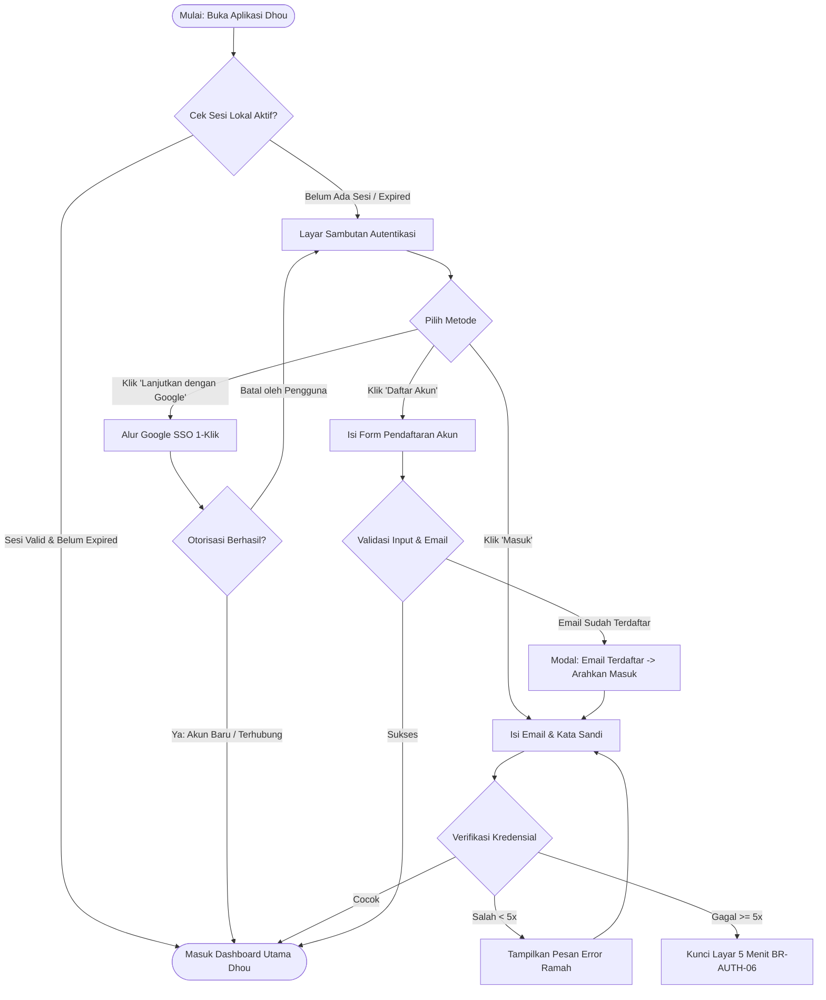
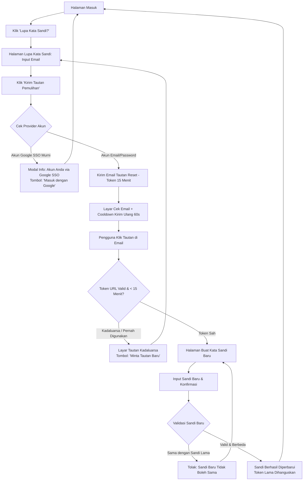

# Product Requirement Document (PRD)

## Document Information

| Item | Detail |
| :--- | :--- |
| **Document ID** | PRD1 |
| **Feature ID** | AUTH-L-01, AUTH-L-02, AUTH-L-03, AUTH-L-04, AUTH-L-05 |
| **Feature Name** | User Authentication, Sign In, and Password Recovery |
| **Application** | Dhou (تطبيق ضوء) — Mobile Web (PWA) & iOS Native Wrapper (CapacitorJS) |
| **Module** | Authentication & Account Security |
| **Sprint** | Sprint 1 |
| **Epic** | User Identity, Access & Account Security |
| **Priority** | Critical (P0) |
| **Status** | Approved |
| **Implementation Status** | Planned |
| **Version** | 2.0 |
| **Last Updated** | 2026-10-31 |
| **Product Owner** | Fariz Mirza Abdillah |
| **Dependencies** | PRD-CORE (User Profile & Streak Engine), Supabase Auth / GoTrue, Google Cloud Console (OAuth 2.0) |

---

## 1. Business Problem

Dhou adalah aplikasi edutech gamifikasi pembelajaran bahasa Arab (*Fusha* dan *'Ammiyyah*). Saat ini sistem belum memiliki mekanisme autentikasi dan manajemen identitas yang terintegrasi, yang menimbulkan kendala bisnis:
1. **Risiko Kehilangan Retensi dan Aset Belajar (Streak & XP)**: Motivasi harian pengguna bergantung pada **Streak Harian (🔥)**, **Energy (🔋)**, dan riwayat hafalan SRS. Tanpa akun terpusat, progres belajar rentan hilang saat cache browser terhapus atau aplikasi ditutup, memicu frustrasi dan tingginya angka *churn*.
2. **Friksi Onboarding pada Perangkat Mobile**: Mengetik form panjang di layar sentuh ponsel (resolusi 360px–402px) sering kali menyebabkan salah ketik (*typo*) pada email dan kata sandi, yang berujung pada tingginya *drop-off rate* calon pengguna sebelum sempat mencoba modul belajar.
3. **Beban Dukungan Operasional Pengguna Lupa Sandi**: Ketiadaan alur pemulihan kata sandi mandiri (*self-service password recovery*) yang aman berpotensi membebani tim operasional dengan tiket manual pemulihan akun.
4. **Kebutuhan Akses Terproteksi (Auth Gate)**: Untuk menjaga integritas data analitik pengguna dan personalisasi kurikulum AI, Dhou membutuhkan pintu masuk tunggal yang aman, cepat, dan andal sejak hari pertama.

---

## 2. Business Value

- **Maksimisasi Konversi Registrasi (*Frictionless Onboarding*)**: Opsi **Google Sign-In 1-Klik** memangkas waktu pendaftaran dari rata-rata 45 detik menjadi $< 6$ detik tanpa perlu verifikasi email manual.
- **Penyimpanan Terpusat & Persistensi Multi-Perangkat**: Data akun langsung terikat pada cloud Supabase/PostgreSQL sejak pertama kali dibuat, memastikan streak harian dan riwayat belajar aman meski berganti perangkat.
- **Pengurangan Beban Tiket Bantuan (Zero-Ops Recovery)**: Alur pemulihan kata sandi mandiri berbasis email token (berlaku 15 menit) memampukan 100% pengguna menyelesaikan lupa sandi tanpa campur tangan CS.
- **Proteksi Aset Pengguna & Keamanan Data**: Pembatasan percobaan login salah berturut-turut (brute-force lockout 5 menit) dan enkripsi standar industri melindungi akun pengguna dari upaya pembajakan.

---

## 3. Purpose

Menyediakan modul **User Authentication & Identity Management** pada aplikasi Dhou dengan arsitektur terpadu yang memfasilitasi alur Masuk (*Sign In*), Pendaftaran Akun (*Sign Up*), Autentikasi Cepat Google (*Google SSO*), Pemulihan Kata Sandi Mandiri (*Forgot & Reset Password*), serta Keluar Akun (*Logout*) secara aman, cepat, ramah pengguna mobile, dan minim friksi.

---

## 4. Objectives

1. Mengimplementasikan alur pendaftaran dan masuk menggunakan kombinasi **Email dan Kata Sandi** dengan validasi interaktif real-time dan proteksi brute-force.
2. Memfasilitasi pendaftaran dan login 1-klik menggunakan **Google Sign-In (OAuth 2.0)** yang kompatibel di platform Mobile Web (PWA) maupun iOS Native Wrapper (CapacitorJS).
3. Menyediakan alur pemulihan kata sandi mandiri (**Lupa Kata Sandi**) melalui pengiriman tautan aman ke email pengguna dengan masa berlaku 15 menit dan limitasi kirim ulang 60 detik.
4. Menerapkan pengamanan form cerdas: deteksi salah ketik domain email populer (misal: `@gmai.com` $\rightarrow$ `@gmail.com`), meter visual kekuatan sandi, dan toggle intip kata sandi.
5. Memastikan alur keluar akun (**Logout**) yang bersih dari menu Profil dengan dialog konfirmasi dan pembersihan seluruh token sesi lokal perangkat.

---

## 5. Scope

### In Scope

- **Masuk Akun (AUTH-L-01)**
  - Form masuk: Input Alamat Email dan Kata Sandi.
  - Fitur intip kata sandi (*Show/Hide Password toggle*).
  - Checkbox persistensi sesi (*Remember Me* / "Ingat saya di perangkat ini").
  - Tombol masuk primer dengan feedback loading 3D button khas Dhou.
  - Proteksi lockout 5 menit setelah 5 kali percobaan login gagal berturut-turut.
- **Google Sign-In 1-Klik (AUTH-L-02)**
  - Tombol resmi "Lanjutkan dengan Google" di layar Masuk dan Daftar.
  - Otorisasi OAuth 2.0 PKCE pada web browser dan Native Google Auth Plugin pada iOS Capacitor.
  - Ekstraksi otomatis profil Google: Nama pengguna, alamat email terverifikasi (`email_verified = true`), dan URL foto avatar.
  - Penautan akun otomatis (*Automatic Account Linking*) jika email Google identik dengan email akun lokal yang sudah ada.
- **Pendaftaran Akun Baru (AUTH-L-03)**
  - Form daftar: Nama Panggilan (2–50 karakter), Alamat Email, Kata Sandi, dan Konfirmasi Kata Sandi.
  - Meter visual kekuatan kata sandi (*Password Strength Indicator*).
  - Deteksi dan saran pintar salah ketik domain email umum (*Smart Typo Suggestion*).
  - Checkbox wajib persetujuan Syarat Ketentuan Layanan & Kebijakan Privasi.
- **Pemulihan Kata Sandi Mandiri (AUTH-L-04)**
  - Form permintaan tautan reset password via input email terdaftar.
  - Layar konfirmasi email terkirim dengan countdown cooldown 60 detik untuk tombol kirim ulang.
  - Halaman pembuatan kata sandi baru berbasis token URL aman (validitas 15 menit, *single-use*).
  - Validasi penolakan kata sandi baru yang sama persis dengan kata sandi sebelumnya.
  - Deteksi solutif jika pengguna Google SSO mencoba meminta reset kata sandi.
- **Keluar Akun / Logout (AUTH-L-05)**
  - Tombol keluar akun di dalam menu/tab Profil.
  - Dialog konfirmasi aksi keluar akun.
  - Pembersihan token JWT, refresh token, dan cache lokal dari penyimpanan perangkat.

### Out of Scope

- Autentikasi berbasis OTP SMS atau WhatsApp (direncanakan untuk fase 2).
- Autentikasi biometrik murni FaceID/TouchID tanpa login awal (direncanakan pasca-rilis stabil).
- Masuk menggunakan Apple ID (ditunda sesuai arahan bisnis).
- Multi-Factor Authentication (MFA / Authenticator App TOTP).
- Mode tamu tanpa login (*Guest Mode* / coba gratis tanpa akun; seluruh pengguna wajib login/daftar di awal).

---

## 6. User Persona

| User Persona | Deskripsi | Peran & Kebutuhan dalam Modul Autentikasi |
| :--- | :--- | :--- |
| **Mahasiswa / Santri (Farhan, 20 th)** | Pembelajar intensif nahwu, sharaf, dan percakapan Arab | Mengutamakan tombol masuk cepat Google SSO di sela jadwal kuliah/halaqah agar streak 🔥 hariannya tidak terputus. |
| **Profesional / Traveler (Aulia, 29 th)** | Belajar di waktu luang perjalanan atau istirahat kantor | Membutuhkan fitur *Remember Me* dan dukungan autofill password manager (iOS Keychain / Chrome Autofill) agar tidak perlu mengetik ulang kredensial. |
| **Pembelajar Mandiri Baru (Budi, 24 th)** | Calon pembelajar yang baru mengunduh/membuka Dhou | Menginginkan antarmuka pendaftaran yang hangat, visual yang bersahabat (ala Duolingo), dan proses registrasi yang selesai dalam hitungan detik. |

---

## 7. User Flow

### 7.1 Alur Utama Autentikasi & Masuk Pengguna

### 7.2 Alur Pemulihan Kata Sandi Mandiri (Forgot & Reset Password)

---

## 8. Feature Specifications (by User Story)

| No. | Nomor US | Judul US | Cakupan Fitur |
| :---: | :--- | :--- | :--- |
| 1 | **US01** | Masuk dengan Email & Kata Sandi (AUTH-L-01) | Autentikasi email dan kata sandi, toggle visibilitas mata, fitur *Remember Me*, penanganan kesalahan anti-user-enumeration, dan proteksi lockout 5 menit setelah 5x gagal berturut-turut. |
| 2 | **US02** | Masuk & Registrasi Cepat via Google SSO (AUTH-L-02) | Autentikasi 1-klik OAuth 2.0 PKCE (Web) dan Native Google Plugin (Capacitor iOS), auto verifikasi email, ekstraksi avatar profil, serta penautan akun otomatis (*account linking*). |
| 3 | **US03** | Pendaftaran Akun Baru & Validasi Cerdas (AUTH-L-03) | Pendaftaran nama, email, sandi dengan meter kekuatan visual, saran cerdas typo domain email umum, dan persetujuan Syarat Ketentuan Layanan. |
| 4 | **US04** | Permintaan Pemulihan Kata Sandi (AUTH-L-04) | Permintaan tautan pemulihan email, penanganan ramah bagi akun Google SSO murni, layar konfirmasi cek email, dan limitasi cooldown kirim ulang 60 detik. |
| 5 | **US05** | Pengaturan Ulang Kata Sandi Baru (AUTH-L-04) | Validasi token tautan URL ($\le 15$ menit, single-use), form kata sandi baru, pencegahan penggunaan kata sandi lama, dan auto-redirect ke halaman masuk. |
| 6 | **US06** | Keluar Akun / Logout (AUTH-L-05) | Navigasi keluar dari tab Profil, dialog konfirmasi modal, pemutusan sesi backend, dan pembersihan total storage lokal perangkat. |

---

### 8.1 US01: Masuk dengan Email & Kata Sandi (AUTH-L-01)

#### 8.1.1 Description
Sebagai pengguna terdaftar Dhou, saya ingin masuk ke aplikasi menggunakan alamat email dan kata sandi saya, dengan opsi intip kata sandi dan opsi "Ingat Saya", agar saya dapat melanjutkan streak belajar harian (🔥) dan mengakses materi personal saya secara aman.

#### 8.1.2 User Journey
1. Pengguna membuka aplikasi Dhou di ponsel dan berada pada halaman Masuk (`/auth/login`).
2. Pengguna melihat logo lentera Dhou, judul sambutan *"Ahlan wa Sahlan!"*, dan subjudul ramah.
3. Pengguna mengetik alamat email pada input email (keyboard mobile otomatis mengaktifkan mode email berkarakter `@` dan `.com`).
4. Pengguna mengetik kata sandi. Karakter secara default disamarkan dengan bullet (`••••`). Pengguna dapat menekan ikon mata (`Eye`) untuk menampilkan teks biasa (`type="text"`), dan menekan ikon `EyeOff` untuk menyamarkan kembali.
5. Pengguna memastikan checkbox *"Ingat saya di perangkat ini"* tercentang (default: aktif).
6. Pengguna menekan tombol primer 3D **"Masuk Sekarang"**.
7. Sistem mengubah status tombol menjadi loading dengan teks *"Memeriksa kredensial..."* dan menonaktifkan tombol untuk mencegah klik ganda.
8. **Kondisi Sukses**: Kredensial valid $\rightarrow$ Sesi disimpan ke penyimpanan lokal $\rightarrow$ Sistem mengalihkan pengguna ke dashboard utama dalam waktu $< 2$ detik.
9. **Kondisi Kredensial Salah**: Sistem menampilkan notifikasi alert merah: *"Email atau kata sandi yang Anda masukkan salah. Silakan periksa kembali."* Teks email pengguna dipertahankan di dalam kolom input agar tidak perlu mengetik ulang.
10. **Kondisi Percobaan Gagal $\ge 5$ Kali**: Sistem mengunci tombol masuk dan memunculkan banner peringatan kuning dengan hitung mundur: *"Terlalu banyak percobaan gagal. Akun dikunci sementara demi keamanan. Coba lagi dalam 05:00 atau gunakan Lupa Kata Sandi."*

#### 8.1.3 Acceptance Criteria
* **AC01.1**: Form masuk menyediakan kolom `Alamat Email*`, `Kata Sandi*`, checkbox `Ingat Saya`, tautan `Lupa Kata Sandi?`, tombol CTA `Masuk Sekarang`, dan pemisah menuju Google SSO.
* **AC01.2**: Tombol intip kata sandi berfungsi secara instan mengubah tipe input antara `password` dan `text`.
* **AC01.3**: Kredensial valid menghasilkan token sesi JWT, disimpan sesuai preferensi Remember Me, dan mengarahkan ke dashboard utama Dhou.
* **AC01.4**: Kredensial yang tidak cocok menghasilkan pesan kesalahan umum yang ramah (*anti-user-enumeration*) tanpa mengosongkan input email pengguna.
* **AC01.5**: Akun yang gagal masuk sebanyak 5 kali berturut-turut wajib diblokir sementara dari upaya login selama 300 detik (5 menit) disertai tampilan hitung mundur (*countdown timer*).
* **AC01.6**: Tombol submit otomatis dinonaktifkan dan menampilkan spinner animasi selama proses autentikasi berlangsung (*anti double-submit*).

#### 8.1.4 UI Specification
##### A. Halaman Masuk (`/auth/login`)
| Elemen UI | Tipe | Status Wajib | Keterangan / Validasi |
| :--- | :--- | :--- | :--- |
| Logo Dhou | Image Asset (48x48px) | - | Ikon lentera Dhou di tengah atas |
| Judul Sambutan | Text Header Bold (Fredoka, 24px) | - | "Ahlan wa Sahlan!" |
| Subjudul Panduan | Text Subheader (Poppins, 14px) | - | "Masuk untuk melanjutkan petualangan bahasa Arabmu." |
| Input Alamat Email | Text Input (`type="email"`) | Ya | Prefix ikon `Mail`, placeholder: "nama@email.com", auto-trim & lowercase |
| Input Kata Sandi | Password Input | Ya | Prefix ikon `Lock`, suffix toggle ikon `Eye`/`EyeOff`, placeholder: "Masukkan kata sandi" |
| Tautan Lupa Sandi | Link Text (Orange Bold) | - | "Lupa Kata Sandi?", navigasi ke `/auth/forgot-password` |
| Checkbox Ingat Saya | Checkbox Input | - | Label: "Ingat saya di perangkat ini", default checked |
| Tombol Masuk Sekarang | Primary 3D Button (Warm Orange `#FF8904`) | Ya | Border bawah `#ED7500` 3px, rounded 12px, font Fredoka 16px semibold putih |
| Divider Pemisah | Center Line Text | - | "atau masuk dengan" |
| Tombol Google SSO | Social Button (White, Gray Border) | Ya | Logo Google multicolor + teks: "Lanjutkan dengan Google" |
| Footer Navigasi | Text Link | - | "Belum punya akun Dhou? Daftar Gratis" (navigasi ke `/auth/register`) |

#### 8.1.5 Business Rules
* **BR-AUTH-01**: Akses modul belajar Dhou wajib melalui akun terdaftar (*Auth Gate*).
* **BR-AUTH-02**: Penanganan kesalahan login tidak boleh membocorkan apakah email terdaftar atau tidak (*anti-user-enumeration*).
* **BR-AUTH-06**: Pembekuan sementara 5 menit diberlakukan setelah 5 kali gagal login berturut-turut pada satu akun.

#### 8.1.6 Validation Rules
* **VAL-AUTH-01**: Alamat email wajib diisi dengan format email valid (`email regex`).
* **VAL-AUTH-02**: Kata sandi wajib diisi, minimal 8 karakter.

#### 8.1.7 Edge Cases
* **EC-AUTH-01**: Pengguna memasukkan spasi di awal/akhir email saat copy-paste -> Sistem otomatis melakukan `.trim().toLowerCase()`.
* **EC-AUTH-04**: Pengguna mencoba klik tombol masuk berkali-kali secara cepat -> Tombol langsung di-disable sejak klik pertama (*debounced*).

#### 8.1.8 Error Handling
* **ERR-AUTH-01**: Email atau kata sandi yang Anda masukkan salah. Silakan periksa kembali.
* **ERR-AUTH-02**: Terlalu banyak percobaan gagal. Akun Anda dikunci sementara selama 5 menit.

---

### 8.2 US02: Masuk & Registrasi Cepat via Google SSO (AUTH-L-02)

#### 8.2.1 Description
Sebagai pengguna mobile yang mengutamakan kepraktisan, saya ingin masuk atau membuat akun Dhou baru dengan satu klik menggunakan Akun Google saya, agar saya tidak perlu mengingat kata sandi baru atau menunggu email aktivasi akun.

#### 8.2.2 User Journey
1. Pengguna berada di layar Masuk atau Daftar dan menekan tombol **"Lanjutkan dengan Google"**.
2. Tombol Google menampilkan status loading spinner halus.
3. **Di Browser Web (PWA)**: Sistem membuka dialog otorisasi Google dengan parameter `prompt: 'select_account'`. Pengguna memilih akun Google yang diinginkan.
4. **Di iOS Native Wrapper (CapacitorJS)**: Sistem memanggil sheet native Google Sign-In (mencegah error 403 `disallowed_useragent` pada WebView).
5. Otorisasi sukses $\rightarrow$ Backend menerima token identitas $\rightarrow$ Sistem mengekstrak nama, email, dan foto profil avatar pengguna.
6. Email pengguna secara otomatis ditandai terverifikasi (`email_verified = true`).
7. **Kasus Email Sudah Ada**: Jika email pengguna sebelumnya terdaftar via email/password manual, sistem secara cerdas menautkan identitas Google ke akun tersebut (*Automatic Account Linking*).
8. Sistem mengalihkan pengguna ke dashboard Dhou dalam keadaan masuk.

#### 8.2.3 Acceptance Criteria
* **AC02.1**: Tombol Google SSO tersedia di halaman Masuk dan Daftar dengan visual resmi Google (logo SVG multicolor dan teks netral).
* **AC02.2**: Otorisasi Google berhasil secara otomatis membuat akun baru atau menghubungkan ke akun yang sudah ada tanpa duplikasi entri data.
* **AC02.3**: Status email dari akun Google otomatis berstatus terverifikasi tanpa requiring konfirmasi email manual.
* **AC02.4**: Pada build iOS Native Capacitor, autentikasi menggunakan Native Google Plugin / SafariViewController guna menjamin kompatibilitas dan terbebas dari blokir 403 WebView.
* **AC02.5**: Jika pengguna membatalkan dialog login Google, sistem mereset tombol loading tanpa menampilkan pesan error teknis.

#### 8.2.4 UI Specification
| Elemen UI | Tipe | Keterangan / Spesifikasi Visual |
| :--- | :--- | :--- |
| Tombol Google | Full-Width Button | Background putih `#FFFFFF`, border halus `#E5E7EB`, hover `#F9FAFB`, rounded 12px |
| Logo Google | SVG Icon (20x20px) | Logo Google "G" 4 warna resmi (Blue, Green, Yellow, Red) |
| Label Tombol | Text Medium (14px) | "Lanjutkan dengan Google" |
| Loading Spinner | Lucide Loader2 (Orange) | Spinner animasi halus menggantikan logo saat otorisasi berjalan |

#### 8.2.5 Business Rules
* **BR-AUTH-03**: Akun Google SSO otomatis terverifikasi status emailnya.
* **BR-AUTH-04**: *Automatic Account Linking* diberlakukan jika email Google identik dengan akun lokal yang sudah ada.

#### 8.2.6 Edge Cases
* **EC-G01**: Aplikasi dibuka di dalam iOS Native WebView -> Menggunakan Native Google SDK untuk menghindari error 403 `disallowed_useragent`.
* **EC-G02**: Pengguna menutup popup Google sebelum selesai -> State loading di-reset secara damai.
* **EC-G03**: Browser memblokir popup Google -> Otomatis fallback ke metode full-page redirect (`redirectTo`).

---

### 8.3 US03: Pendaftaran Akun Baru & Validasi Cerdas (AUTH-L-03)

#### 8.3.1 Description
Sebagai calon pembelajar bahasa Arab di Dhou, saya ingin mendaftar akun baru dengan nama panggilan, email, dan kata sandi yang kuat dengan bantuan panduan visual interaktif, agar akun saya terlindungi dan siap digunakan untuk belajar.

#### 8.3.2 User Journey
1. Pengguna membuka halaman Daftar (`/auth/register`).
2. Pengguna memasukkan **Nama Panggilan** (contoh: Fariz).
3. Pengguna memasukkan **Alamat Email**. Jika pengguna salah mengetik domain umum (misal `fariz@gmai.com`), saat kursor keluar (*onBlur*), sistem memunculkan banner saran pintar: *"Maksud Anda fariz@gmail.com? [Gunakan Ini]"*.
4. Pengguna mengetik **Kata Sandi**. Di bawah kolom sandi, bar indikator kekuatan sandi berubah dinamis:
   - *Merah*: Lemah (panjang $< 8$ karakter).
   - *Kuning*: Cukup (8 karakter tapi belum ada kombinasi angka/huruf besar).
   - *Hijau*: Kuat (memenuhi minimal 8 karakter, huruf besar, huruf kecil, dan angka).
5. Pengguna mengetik **Konfirmasi Kata Sandi**. Sistem memvalidasi kesamaan nilai secara instan.
6. Pengguna mencentang checkbox *"Saya menyetujui Ketentuan Layanan & Kebijakan Privasi Dhou"*.
7. Pengguna menekan tombol primer **"Buat Akun Saya"**.
8. Sistem membuat akun baru di database dan langsung mengarahkan pengguna ke dashboard belajar.

#### 8.3.3 Acceptance Criteria
* **AC03.1**: Form registrasi memuat input Nama Panggilan (2–50 char), Email, Kata Sandi, Konfirmasi Kata Sandi, dan Checkbox Ketentuan Layanan.
* **AC03.2**: Sistem menyajikan meter kekuatan kata sandi visual secara real-time.
* **AC03.3**: Sistem mendeteksi kesalahan ketik pada domain email populer dan menampilkan saran perbaikan.
* **AC03.4**: Jika email yang dimasukkan sudah pernah terdaftar, sistem menampilkan modal dialog yang mengarahkan pengguna untuk login atau memulihkan sandi.
* **AC03.5**: Pendaftaran baru berhasil langsung mengaktifkan sesi pengguna dan membuka dashboard utama.

#### 8.3.4 UI Specification
| Elemen UI | Tipe | Wajib | Keterangan / Validasi |
| :--- | :--- | :--- | :--- |
| Input Nama Panggilan | Text Input | Ya | Min. 2, maks. 50 karakter (alfabet Latin atau Arab) |
| Input Alamat Email | Text Input (`type="email"`) | Ya | Format email valid, auto-trim |
| Smart Typo Banner | Suggestion Banner (Biru) | - | "Maksud Anda [email_saran]? [Gunakan Ini]" |
| Input Kata Sandi | Password Input | Ya | Min. 8 karakter, huruf besar, kecil, angka |
| Meter Kekuatan Sandi | Segmented Progress Bar | - | 3 bar warna: Merah (Lemah), Kuning (Cukup), Hijau (Kuat) |
| Input Konfirmasi Sandi | Password Input | Ya | Wajib sama persis dengan input kata sandi |
| Checkbox Syarat & Ketentuan | Checkbox Input | Ya | Teks tautan: "Saya menyetujui Ketentuan Layanan & Kebijakan Privasi" |
| Tombol Buat Akun Saya | Primary 3D Button | Ya | Warna Warm Orange `#FF8904`, disabled jika form belum valid |

#### 8.3.5 Business Rules
* **BR-AUTH-02**: 1 alamat email hanya dapat digunakan untuk 1 akun Dhou.
* **BR-AUTH-05**: Standar keamanan kata sandi wajib minimal 8 karakter dengan huruf besar, huruf kecil, dan angka.

#### 8.3.6 Error Handling
* **ERR-AUTH-03**: Alamat email ini sudah terdaftar di Dhou. Silakan masuk atau gunakan fitur Lupa Kata Sandi.
* **ERR-AUTH-04**: Konfirmasi kata sandi tidak cocok. Mohon periksa kembali.

---

### 8.4 US04: Permintaan Pemulihan Kata Sandi Mandiri (AUTH-L-04)

#### 8.4.1 Description
Sebagai pengguna yang lupa kata sandinya, saya ingin meminta tautan pemulihan kata sandi melalui alamat email saya, agar saya dapat mengatur ulang kata sandi dan mengakses kembali akun saya secara mandiri.

#### 8.4.2 User Journey
1. Pengguna mengklik tautan *"Lupa Kata Sandi?"* pada halaman login.
2. Pengguna tiba di halaman Lupa Kata Sandi (`/auth/forgot-password`).
3. Pengguna memasukkan alamat email terdaftar dan menekan tombol **"Kirim Tautan Pemulihan"**.
4. **Kasus Akun Google SSO Murni**: Jika email tersebut terdaftar hanya via Google Sign-In, sistem menampilkan dialog informatif: *"Akun Anda terdaftar menggunakan Google Sign-In. Anda dapat langsung masuk dengan tombol Google"* lengkap dengan tombol CTA langsung.
5. **Kasus Akun Email/Sandi**: Sistem mengirimkan email berisi tautan token pemulihan (berlaku 15 menit), lalu mengalihkan pengguna ke layar Cek Email (`/auth/check-email`).
6. Layar Cek Email menampilkan alamat email tujuan dan tombol kirim ulang dengan timer hitung mundur 60 detik (*anti-spam cooldown*).

#### 8.4.3 Acceptance Criteria
* **AC04.1**: Form meminta input email terdaftar dan memvalidasi formatnya sebelum pengiriman.
* **AC04.2**: Sistem mendeteksi akun yang mendaftar via Google SSO dan memberikan panduan masuk yang tepat.
* **AC04.3**: Email pemulihan dikirimkan dengan token aman yang memiliki masa kadaluarsa 15 menit.
* **AC04.4**: Layar konfirmasi cek email mengunci tombol kirim ulang selama 60 detik untuk mencegah spam email transaksional.

#### 8.4.4 UI Specification
| Elemen UI | Tipe | Keterangan / Spesifikasi Visual |
| :--- | :--- | :--- |
| Judul Halaman | Text Header Bold | "Lupa Kata Sandi?" |
| Deskripsi Panduan | Body Text Gray | "Masukkan email Anda untuk menerima instruksi pemulihan." |
| Input Email | Text Input (`type="email"`) | Input email dengan autofocus |
| Tombol Kirim Tautan | Primary 3D Button | Label: "Kirim Tautan Pemulihan" |
| Layar Cek Email | Confirmation Screen | Ilustrasi amplop bersinar, teks email tujuan tebal |
| Cooldown Kirim Ulang | Timer Counter Text | "Kirim ulang email dalam 45s" (tombol disabled hingga 0s) |

#### 8.4.5 Business Rules
* **BR-AUTH-07**: Tautan pemulihan berlaku maksimal 15 menit dan bersifat sekali pakai (*single-use*).
* **BR-AUTH-08**: Jeda kirim ulang (*rate limiting*) dibatasi minimal 60 detik antar request.

---

### 8.5 US05: Pengaturan Ulang Kata Sandi Baru (AUTH-L-04)

#### 8.5.1 Description
Sebagai pengguna yang menerima email pemulihan, saya ingin membuka tautan tersebut untuk membuat kata sandi baru yang aman, agar kata sandi lama saya diperbarui dan saya dapat masuk kembali ke akun saya.

#### 8.5.2 User Journey
1. Pengguna membuka kotak masuk email dan mengklik tautan tombol *"Atur Ulang Kata Sandi"*.
2. Browser membuka halaman Reset Sandi (`/auth/reset-password?token=XYZ`).
3. Sistem memvalidasi token URL secara otomatis:
   - **Jika Token Expired ($>15$ menit) atau Rusak**: Menampilkan layar error *"Tautan Kadaluarsa"* dengan tombol *"Minta Tautan Baru"*.
   - **Jika Token Sah**: Menampilkan form pembuatan kata sandi baru.
4. Pengguna memasukkan kata sandi baru dan mengonfirmasikannya.
5. Jika pengguna memasukkan kata sandi yang sama persis dengan kata sandi lama, sistem menolak dan meminta variasi lain.
6. Pengguna menekan tombol **"Simpan Kata Sandi Baru"**.
7. Sistem memperbarui kata sandi, membatalkan token tersebut (*single-use*), dan mengarahkan pengguna ke halaman login dengan toast sukses hijau.

#### 8.5.3 Acceptance Criteria
* **AC05.1**: Halaman reset kata sandi memvalidasi keabsahan token URL sebelum merender formulir input.
* **AC05.2**: Token yang kedaluwarsa ($>15$ menit) atau sudah pernah digunakan wajib ditolak dengan pesan yang jelas.
* **AC05.3**: Kata sandi baru wajib memenuhi aturan kekuatan sandi (`BR-AUTH-05`) dan tidak boleh sama dengan kata sandi sebelumnya.
* **AC05.4**: Pembaruan kata sandi yang sukses otomatis membatalkan seluruh sesi login aktif lainnya demi keamanan akun.

#### 8.5.4 Error Handling
* **ERR-AUTH-05**: Tautan pemulihan telah kadaluarsa atau sudah pernah digunakan. Silakan minta tautan baru.
* **ERR-AUTH-06**: Kata sandi baru tidak boleh sama dengan kata sandi sebelumnya.

---

### 8.6 US06: Keluar Akun / Logout (AUTH-L-05)

#### 8.6.1 Description
Sebagai pengguna yang telah selesai belajar atau menggunakan perangkat bersama, saya ingin keluar dari akun saya melalui tab Profil, agar sesi saya ditutup dan data pribadi saya tidak dapat diakses orang lain.

#### 8.6.2 User Journey
1. Pengguna membuka tab **Profil** di navigasi bawah aplikasi Dhou.
2. Pengguna menggulir ke bagian bawah menu pengaturan dan menekan opsi **"Keluar Akun"** (ikon pintu keluar berwarna merah).
3. Sistem memunculkan modal dialog konfirmasi:
   - Judul: *"Keluar dari Akun?"*
   - Pesan: *"Apakah Anda yakin ingin keluar? Streak dan energi belajarmu tetap tersimpan aman di cloud."*
   - Tombol: **"Batal"** (outline) dan **"Keluar"** (merah solid).
4. Pengguna menekan **"Keluar"**.
5. Sistem memutus sesi ke server backend, menghapus seluruh access token dan cache lokal dari perangkat, lalu mengarahkan pengguna ke layar sambutan login.

#### 8.6.3 Acceptance Criteria
* **AC06.1**: Menu keluar akun tersedia pada tab Profil dengan indikator visual yang jelas.
* **AC06.2**: Aksi keluar mewajibkan konfirmasi dialog untuk mencegah ketidaksengajaan.
* **AC06.3**: Logout sukses menghapus seluruh token JWT dan kredensial lokal dari storage perangkat secara tuntas (*Clean Logout*).

---

## 9. Business Rules Summary

| ID Aturan | Ringkasan Kebijakan Bisnis |
| :--- | :--- |
| **BR-AUTH-01** | **Auth Gate Mandatory**: Pengguna wajib login/daftar untuk mengakses seluruh materi belajar Dhou. |
| **BR-AUTH-02** | **Unique Account Email**: 1 email hanya untuk 1 akun Dhou; tolak duplikasi pendaftaran. |
| **BR-AUTH-03** | **Google Auto-Verified**: Email dari akun Google SSO otomatis berstatus terverifikasi. |
| **BR-AUTH-04** | **Smart Account Linking**: Penautan otomatis akun Google ke akun lokal yang memiliki email identik. |
| **BR-AUTH-05** | **Password Standard**: Minimal 8 karakter dengan kombinasi huruf besar, huruf kecil, dan angka. |
| **BR-AUTH-06** | **Brute-Force Lockout**: Pembekuan form login 5 menit setelah 5 kali gagal berturut-turut. |
| **BR-AUTH-07** | **Token Recovery Lifespan**: Tautan reset password hanya berlaku 15 menit dan bersifat sekali pakai. |
| **BR-AUTH-08** | **Resend Cooldown**: Jeda waktu minimal 60 detik antar permintaan kirim ulang email reset. |

---

## 10. Business Metrics & KPIs

| Key Performance Indicator (KPI) | Definisi Metrik | Target Bisnis MVP |
| :--- | :--- | :--- |
| **Auth Conversion Rate** | Persentase pengunjung yang berhasil menyelesaikan proses masuk/daftar. | $\ge 85\%$ |
| **Average Time-to-Auth** | Waktu rata-rata dari membuka layar awal hingga masuk dashboard. | $\le 15$ detik (Google SSO $\le 6$ detik) |
| **Drop-Off on Auth Screen** | Persentase calon pengguna yang menutup aplikasi pada layar login/daftar. | $\le 7\%$ |
| **Self-Service Recovery Rate** | Persentase pengguna lupa sandi yang berhasil reset mandiri tanpa tiket CS. | $\ge 80\%$ |

---

## 14. Rujukan Spesifikasi Implementasi

Detail teknis, kontrak API, skema validasi Zod, dan matriks kasus ekstrem teknis berada pada dokumen FRD:
- [Pemetaan Kebutuhan Fungsional](../FRD/FRD1%20-%20User%20Authentication,%20Sign%20In,%20and%20Password%20Recovery.md#11-pemetaan-kebutuhan-produk-prd-ke-fungsionalitas-sistem-frd).
- [Kontrak API Definitif & Penanganan Error](../FRD/FRD1%20-%20User%20Authentication,%20Sign%20In,%20and%20Password%20Recovery.md#5-concrete-api-design).
- [Skema Persistensi Database PostgreSQL](../FRD/FRD1%20-%20User%20Authentication,%20Sign%20In,%20and%20Password%20Recovery.md#6-persistence-and-ownership).
- [Matriks Lengkap Kasus Ekstrem Fungsional](../FRD/FRD1%20-%20User%20Authentication,%20Sign%20In,%20and%20Password%20Recovery.md#102-matriks-kasus-ekstrem-fungsional-edge-cases-matrix).
