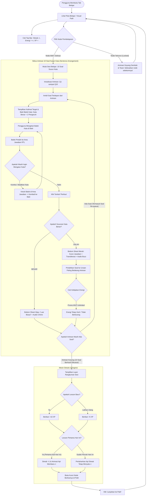

# Product Requirement Document (PRD)

## Document Information

| Item | Detail |
| :--- | :--- |
| **Document ID** | PRD2 |
| **Feature ID** | PATH-L-01, PATH-L-02, PATH-L-03, PATH-L-04, PATH-L-05 |
| **Feature Name** | Gamified Learning Path, Sentence Arrangement, Energy Engine, and Daily Streak |
| **Application** | Dhou (تطبيق ضوء) — Mobile Web (PWA) & iOS Native Wrapper (CapacitorJS) |
| **Module** | Gamified Learning Path & Progression Core |
| **Sprint** | Sprint 2 |
| **Epic** | Learning Progression, Gamification & Sentence Builder |
| **Priority** | Critical (P0) |
| **Status** | Approved |
| **Implementation Status** | Planned |
| **Version** | 1.0 |
| **Last Updated** | 2026-11-02 |
| **Product Owner** | Fariz Mirza Abdillah |
| **Dependencies** | PRD1 (User Authentication), Design System (Figma Dhou), Research Reference Mapping (4-Pillar Cycle) |

---

## 1. Business Problem

Dhou adalah platform pembelajaran bahasa Arab adaptif (*Fusha* dan *'Ammiyyah*). Setelah pengguna masuk melalui gerbang autentikasi (PRD1), mereka membutuhkan media latihan bahasa terstruktur (*Structured Language Practice*) yang mengonversi pemahaman pasif dari video menjadi kemampuan kognitif aktif.

Ketiadaan modul *Gamified Learning Path* pada fase ini menimbulkan hambatan kritis:
1. **Disorientasi Alur Belajar & Penurunan Retensi D1–D7**: Pembelajar bahasa Arab mandiri mudah kehilangan arah tanpa peta kurikulum bertahap (*Path Tree*). Ketiadaan struktur jelas memicu kebingungan dan tingginya angka pengguna yang meninggalkan aplikasi (*drop-off*).
2. **Kelemahan Kuis Konvensional dalam Melatih Sintaksis Arab**: Pembelajaran susunan kalimat (*nahwu* dan pola frasa percakapan) tidak efektif jika hanya diuji dengan pilihan ganda pasif. Dibutuhkan latihan kinestetik berbasis susun kata (*Sentence Arrangement*) yang mendukung ortografi Arab (arah baca kanan-ke-kiri/RTL, harakat lengkap, dan huruf sambung) disertai kata pengecoh (*distractors*) yang menguji ketelitian.
3. **Fluktuasi Motivasi Harian Pembelajar**: Konsistensi harian adalah kunci kefasihan bahasa. Tanpa indikator komitmen harian yang tegas seperti **Api Streak (🔥)** dengan aturan yang jelas (minimal 1 sesi tuntas per hari kalender), motivasi belajar pengguna cepat meredup.
4. **Dilema Monetisasi Energi vs Akselerasi Adopsi Pengguna MVP**:
   - Sistem kuota energi (*Energy/Lives*) adalah standar industri penting untuk monetisasi langganan berbayar (*Unlimited Energy*).
   - Namun, membatasi energi pengguna Free Plan (misal: memblokir belajar setelah 5 kali salah) di awal peluncuran MVP akan merusak pengalaman belajar dan menghambat pengujian kurikulum.
   - Diperlukan arsitektur sistem energi yang dirancang matang untuk kebutuhan komersial masa depan, namun memiliki kebijakan khusus MVP yang memberikan **Unlimited Energy bagi pengguna Free Plan** tanpa perlu merombak skema basis data di masa mendatang.

---

## 2. Business Value

- **Peningkatan Retensi Belajar Harian (D7 & D30 Retention)**: Mekanisme visual **Api Streak Harian (🔥)** yang menyala saat menyelesaikan minimal 1 lesson terbukti meningkatkan retensi belajar harian hingga $>40\%$.
- **Penguasaan Sintaksis Aktif Berbasis Gamifikasi**: Latihan **Susun Kata (*Sentence Arrangement*)** dengan tepat 10 butir soal dan 2 kata pengecoh melatih pembelajar membedakan urutan kata subjek-predikat-objek dalam *Fusha* dan ragam lisan *'Ammiyyah* secara aktif dan menyenangkan.
- **Pemberantasan Frustrasi Pengguna via Model MVP Unlimited Energy**: Pengguna bebas mencoba dan belajar tanpa takut terblokir kuota baterai saat peluncuran awal, menciptakan kepuasan pengguna (*high CSAT*) dan ulasan positif aplikasi.
- **Fondasi Monetisasi Masa Depan Siap-Pakai (*Future-Proof Paywall Architecture*)**: Sistem kuota energi didesain sejak awal di level data dan API, sehingga pengaktifan kuota 5 energi harian untuk Free Plan dapat diaktifkan secara instan via *feature flag* saat versi berbayar diluncurkan.
- **Tingkat Penguasaan Materi Penuh (*100% Mastery via Error Re-queuing*)**: Soal yang salah dijawab wajib diulang di akhir sesi hingga benar, menjamin pembelajar benar-benar paham sebelum melangkah ke node berikutnya.

---

## 3. Purpose

Menyediakan modul **Gamified Learning Path** pada aplikasi Dhou yang memfasilitasi visualisasi peta navigasi materi (*Unit & Lesson Nodes*), sesi latihan interaktif penyusunan kalimat berbahasa Arab (*Sentence Arrangement*) sebanyak 10 butir soal dengan 2 kata pengecoh, mekanisme pengulangan soal salah di akhir sesi (*Error Re-queue*), mesin penghitung api streak harian (*Daily Streak Engine*), serta infrastruktur energi cerdas (*Energy Engine*) dengan kebijakan promosi *unlimited energy* di fase MVP.

---

## 4. Objectives

1. Mengimplementasikan peta belajar interaktif (**Visual Learning Path Tree**) dengan hierarki *Unit $\rightarrow$ Lesson Nodes* yang memiliki 3 status visual jelas: *Terkunci (Locked)*, *Aktif (Active / Current)*, dan *Selesai (Completed)*.
2. Membangun 1 varian latihan kuis utama untuk MVP: **Susun Kata Arab (*Sentence Arrangement*)** dengan parameter:
   - Tepat **10 butir soal** per sesi lesson.
   - Tepat **2 kata pengecoh (*distractors*)** pada setiap soal di baki kata acak (*Word Bank Tray*).
   - Dukungan ortografi Arab RTL (`dir="rtl"`), font Amiri/Noto Sans Arabic dengan harakat lengkap, serta tombol pemutar audio pengucapan.
3. Menerapkan mekanisme **Error Re-queuing (Mastery Loop)**: Soal yang salah dijawab otomatis dipindahkan ke urutan paling belakang sesi kuis dan wajib diselesaikan dengan benar sebelum sesi dinyatakan tuntas.
4. Mengembangkan mesin kalkulasi **Daily Streak (🔥)** otomatis berbasis zona waktu lokal pengguna (`user_timezone`):
   - Minimal menyelesaikan 1 sesi lesson penuh (10 butir soal tuntas) dalam 1 hari kalender lokal (00:00:00 – 23:59:59) untuk menyalakan/mempertahankan api streak.
   - Menampilkan status visual api membara (aktif), redup/abu-abu (berisiko putus), dan padam/reset ke 0 jika terlewat 1 hari penuh.
5. Merancang arsitektur **Energy Engine (🔋)**:
   - Skema model data siap langganan: Free Plan (5 kuota harian) vs Premium Plan (Unlimited $\infty$).
   - Kebijakan Promo MVP: Free Plan mendapatkan status *Unlimited Energy Promo* (jawaban salah tidak memotong energi dan tidak memblokir sesi belajar).
   - Indikator UI di Top Bar menampilkan status baterai dengan simbol tak hingga (`⚡ ∞`).
6. Menampilkan layar rangkuman penyelesaian sesi (**Lesson Summary Modal**) dengan perolehan XP (+10 XP untuk sesi baru, +5 XP untuk latihan ulang), persentase akurasi percobaan pertama, animasi perayaan api streak, dan pembukaan kunci node berikutnya di Path.

---

## 5. Scope

### In Scope

- **Peta Jalur Belajar / Visual Path (PATH-L-01)**
  - Banner Unit: Nomor Unit, Judul Pembelajaran (misal: *Unit 1: Perkenalan & Sapaan Sehari-hari*), dialek target, dan indikator progres.
  - Jalur Node Berkelok (Zig-zag Path):
    - *Locked Node*: Berwarna abu-abu, ikon gembok, memicu getaran dan pesan peringatan saat disentuh.
    - *Active Node (Current)*: Berwarna Warm Orange (`#FF8904`), animasi denyut (*pulse glow*), tooltip melayang "Mulai!".
    - *Completed Node*: Berwarna Dialect Blue (`#51A2FF`) dengan ikon centang putih, dapat diakses kembali untuk latihan ulang.
  - Header navigasi atas (*Top Navigation Bar*): Menampilkan indikator Api Streak (🔥), Indikator Energi (⚡ $\infty$), dan Akumulasi Poin XP.
  - Fitur *Auto-scroll Viewport*: Otomatis memusatkan layar ke node aktif saat halaman dimuat.
- **Sesi Latihan Susun Kata / Sentence Arrangement (PATH-L-02)**
  - Header kuis: Tombol keluar (X) dengan konfirmasi batal, Progress Bar persentase penyelesaian 10 soal, dan badge energi tak terbatas.
  - Kartu Soal:
    - Instruksi Bahasa Indonesia: *"Susun kalimat ini ke dalam bahasa Arab"*.
    - Kalimat target arti (contoh: *"Halo, selamat pagi"*).
    - Label variasi dialek (*Fusha* / *Ammiyyah Mesir* / *Ammiyyah Syam*).
    - Tombol audio penutur asli untuk mendengarkan pelafalan kalimat.
  - Area Susun Kalimat (*Answer Drop Zone*):
    - Kontainer RTL dengan placeholder garis bawah atau slot balok.
    - Mengetuk kata di Word Bank akan memindahkan balok ke Answer Zone secara berurutan.
    - Mengetuk balok di Answer Zone akan mengembalikannya ke posisi semula di Word Bank.
  - Wadah Balok Kata (*Word Bank Tray*):
    - Berisi balok kata pembentuk kalimat benar ditambah **tepat 2 kata pengecoh (*distractor tiles*)**.
    - Balok kata berharakat lengkap dan diacak susunannya (*shuffled*) setiap kali soal dimuat.
    - Balok yang sudah dipilih berubah menjadi slot transparan (*ghost placeholder*).
  - Validasi & Umpan Balik:
    - Tombol "Periksa" aktif jika minimal 1 balok telah disusun di Answer Zone.
    - Jawaban Benar: Lembar bawah hijau (`#22C55E`), bunyi nada sukses (*chime*), tombol "Lanjut".
    - Jawaban Salah: Lembar bawah merah (`#EF4444`), nada koreksi (*buzz*), menampilkan kunci jawaban tepat + transliterasi, tombol "Mengerti".
- **Mekanisme Antrean & Pengulangan Soal Salah (PATH-L-03)**
  - Antrean kuis awal berisi 10 soal: $[Q_1, Q_2, \dots, Q_{10}]$.
  - Jika soal $Q_k$ dijawab salah, soal dipindahkan ke ekor antrean kuis (*re-queued to the end*).
  - Soal yang diulang diacak kembali susunan balok katanya saat muncul di akhir sesi.
  - Sesi kuis hanya dinyatakan selesai jika antrean soal telah kosong ($0$ soal tersisa).
  - Menghitung akurasi berbasis percobaan pertama (*first-attempt accuracy*).
- **Mesin Energi Fleksibel & Kebijakan MVP Unlimited (PATH-L-04)**
  - Atribut basis data: `energy_count`, `max_energy` (default 5), `is_unlimited_energy`, `last_energy_refill_at`.
  - Feature Flag MVP: `ENV_MVP_UNLIMITED_ENERGY = true`.
  - Pada mode MVP: Jawaban salah **tidak memotong kuota energi**. Tidak ada batasan sesi belajar harian.
  - Visual Top Bar: Ikon baterai/petir dengan simbol tak hingga `⚡ ∞` dan dialog info promo MVP.
  - Logika arsitektur siap-pakai: Saat flag dimatikan pasca-MVP, sistem otomatis beralih ke aturan 5 energi, refill 1 energi per 4 jam, dan pemblokiran saat energi = 0.
- **Mesin Api Streak Harian / Daily Streak Engine (PATH-L-05)**
  - Penentuan hari kalender berbasis zona waktu lokal pengguna (`user_timezone`, contoh: `Asia/Jakarta`).
  - Syarat aktivasi: Menyelesaikan minimal **1 sesi lesson penuh (10 butir soal tuntas)** dalam rentang 00:00:00 – 23:59:59 waktu lokal.
  - Status Streak:
    - *Aktif Hari Ini (Active)*: Api menyala terang oranye-kuning beranimasi, counter bertambah +1 (maksimal 1 kali per hari).
    - *Pending / Berisiko (At Risk)*: Pengguna menyelesaikan kemarin tapi belum hari ini. Api berwarna abu-abu redup.
    - *Padam / Reset (Broken)*: Pengguna melewati satu hari kalender penuh tanpa belajar. Streak direset ke 0.
- **Layar Rangkuman Sesi / Lesson Summary (PATH-L-06)**
  - Tampilan modal pasca-soal terakhir selesai:
    - Banner apresiasi keberhasilan (*"Sesi Selesai! Kamu Hebat!"*).
    - Perolehan XP: **+10 XP** untuk lesson baru, **+5 XP** untuk latihan ulang (*review*).
    - Persentase akurasi pengerjaan.
    - Animasi ledakan api streak (*flame burst*) saat lesson pertama hari ini selesai.
    - Tombol "Lanjutkan ke Path" yang otomatis membuka kunci node berikutnya.

### Out of Scope

- Varian kuis selain Susun Kata (seperti *Listen and Choose*, *Fill in the Blank*, *Record-and-Compare*, *Voice Shadowing* disimpan untuk Sprint 3 & 4).
- Pembelian koin atau item pelindung streak (*Streak Freeze*) di toko (*Shop*) (direncanakan pasca-MVP).
- Pengurangan kuota energi riil dan gerbang pembayaran langganan *Dhou Super / Unlimited Energy* (UI & skema disiapkan, pemotongan kuota dinonaktifkan di MVP).
- Fitur leaderboard sosial dan liga mingguan antar-pengguna (disimpan untuk rilis v2.0).

---

## 6. User Persona

### Persona 1: Rian (24 Tahun) – Pembelajar Mandiri Pemula
- **Karakteristik**: Mahasiswa tingkat akhir yang sedang mempersiapkan diri bekerja di kawasan Timur Tengah.
- **Tujuan**: Memahami susunan kalimat percakapan praktis secara bertahap tanpa harus menghafal rumus tata bahasa teoritis yang rumit.
- **Pain Points**: Mudah bosan dengan teks statis buku pelajaran, sering putus belajar jika tidak ada pemicu konsistensi harian, dan frustrasi jika baru salah menjawab 2 kali langsung dilarang belajar karena kehabisan baterai/energi.
- **Ekspektasi di Dhou**: Jalur belajar terstruktur seperti game, latihan balok kata Arab yang responsif di layar ponsel, api streak yang membakar semangat harian, serta kebebasan mencoba sepuasnya tanpa takut kehabisan energi di masa awal belajar.

### Persona 2: Sarah (29 Tahun) – Profesional Sibuk & Pembelajar Konsisten
- **Karakteristik**: Karyawan swasta yang hanya memiliki waktu luang 10–15 menit di sela-sela perjalanan komuter atau menjelang tidur malam.
- **Tujuan**: Membangun kebiasaan harian (*daily habit*) belajar bahasa Arab secara disiplin.
- **Pain Points**: Kecewa berat jika streak belajarnya hangus akibat inkonsistensi zona waktu server. Kehilangan arah jika materi yang dipelajari terlalu panjang dan tidak tuntas.
- **Ekspektasi di Dhou**: Kepastian sesi yang ringkas (1 lesson = 10 soal), indikator api streak yang transparan di bilah atas, dan kejelasan bahwa menyelesaikan 1 lesson per hari sudah cukup untuk menjaga api belajarnya tetap menyala.

---

## 7. User Flow & Navigation Diagram

Berikut adalah alur perjalanan pengguna dari peta jalur belajar (*Visual Path*), pengerjaan 10 soal susun kata, penanganan antrean soal salah, hingga aktivasi Api Streak dan pembukaan kunci node berikutnya:



---

## 8. Feature Specifications per User Story

### US-PATH-01: Navigasi Visual Path & Node Belajar

| Attribute | Specification |
| :--- | :--- |
| **User Story ID** | US-PATH-01 |
| **Feature ID** | PATH-L-01 |
| **Title** | Visual Learning Path Tree & Progression Navigation |
| **Priority** | Critical (P0) |
| **Description** | Sebagai pembelajar bahasa Arab, saya ingin melihat peta jalur belajar (*Learning Path Tree*) dengan visualisasi node berkelok dan status yang jelas (Selesai, Aktif, Terkunci) per unit agar saya memahami posisi dan arah kemajuan belajar saya. |

#### User Journey
1. Pengguna membuka tab "Belajar" (*Learn*) pada bilah navigasi bawah (*Bottom Navigation Bar*).
2. Sistem menampilkan Unit Banner di bagian atas: Nomor Unit, Judul Pembelajaran (misal: *Unit 1: Perkenalan & Sapaan Sehari-hari*), dialek target (*Fusha*), dan persentase progres unit.
3. Di bawah banner, jalur belajar membentang secara vertikal dengan pola zig-zag bergantian (kiri - tengah - kanan - tengah - kiri).
4. Pengguna melihat node aktif saat ini memiliki efek lingkaran berdenyut (*subtle pulse glow*) berwarna Warm Orange (`#FF8904`) dengan tooltip melayang bertuliskan "Mulai!".
5. Node-node sebelum node aktif ditandai lingkaran biru/hijau dengan ikon centang putih menandakan telah selesai (*Completed*).
6. Node-node setelah node aktif berwarna abu-abu redup dengan ikon gembok terkunci (*Locked*).
7. Pengguna mengetuk node aktif untuk memulai sesi belajar 10 soal.

#### Acceptance Criteria
- **AC-PATH-01-A (Visual Layout):** Sistem wajib merender tata letak pohon kurikulum berurutan dari atas ke bawah dengan posisi horizontal zig-zag yang proporsional pada resolusi mobile (360px–430px).
- **AC-PATH-01-B (Node States):** Setiap node wajib mencerminkan satu dari tiga status valid:
  - `COMPLETED`: Lingkaran penuh warna Dialect Blue (`#51A2FF`), ikon centang putih, dapat diklik untuk sesi latihan ulang (+5 XP).
  - `CURRENT`: Lingkaran warna Warm Orange (`#FF8904`), beranimasi denyut (*pulsing halo*), tooltip "Mulai!", dapat diklik untuk memulai sesi baru (+10 XP).
  - `LOCKED`: Lingkaran abu-abu `#D1D5DB`, ikon gembok `#9CA3AF`, tidak dapat diklik untuk memulai sesi baru.
- **AC-PATH-01-C (Locked Click Feedback):** Jika pengguna mengetuk node berstatus `LOCKED`, sistem wajib memunculkan animasi goyang (*shake animation*) pada gembok disertai pesan toast: *"Selesaikan pelajaran sebelumnya terlebih dahulu untuk membuka kunci materi ini."*
- **AC-PATH-01-D (Auto-scroll to Active):** Posisi scroll viewport halaman Path wajib otomatis memusatkan tampilan (*auto-scroll into view*) ke node berstatus `CURRENT` saat halaman pertama kali dimuat.

#### UI Specification Table

| UI Component | Spec / Token | Visual State | Interaction Behavior |
| :--- | :--- | :--- | :--- |
| **Unit Banner Card** | Bg: `#FF8904`, Radius: `16px`, Padding: `16px`, Text: Fredoka Bold | Standar | Sticky di atas saat scroll melewati unit, memuat judul unit dan dialek target |
| **Active Node Button** | Diameter: `68px`, Bg: `#FF8904`, Border bottom: `4px solid #D67000` (3D Button Dhou), Radius: `9999px` | Current (Pulsing) | Animasi *scale 0.96* saat disentuh, membuka modal dialog pra-sesi kuis |
| **Completed Node** | Diameter: `60px`, Bg: `#51A2FF`, Border bottom: `4px solid #2B7CD4`, Ikon: Checkmark putih | Completed | Membuka modal konfirmasi latihan ulang (+5 XP) |
| **Locked Node** | Diameter: `60px`, Bg: `#E5E7EB`, Border bottom: `4px solid #D1D5DB`, Ikon: Gembok abu-abu | Disabled / Locked | Animasi getar (*shake 0.3s*) + haptic error saat disentuh |
| **Path Connectors** | Garis lengkung SVG / dashed line, tebal `6px`, warna: `#FED7AA` (aktif) atau `#E5E7EB` (terkunci) | Background | Menghubungkan titik tengah antar-lingkaran node secara berkesinambungan |

---

### US-PATH-02: Latihan Interaktif Susun Kata (Sentence Arrangement)

| Attribute | Specification |
| :--- | :--- |
| **User Story ID** | US-PATH-02 |
| **Feature ID** | PATH-L-02 |
| **Title** | Arabic Sentence Arrangement with Exactly 2 Distractors |
| **Priority** | Critical (P0) |
| **Description** | Sebagai pembelajar bahasa Arab, saya ingin menyusun kata-kata acak berbahasa Arab (*Fusha* / *'Ammiyyah*) menjadi kalimat yang benar dengan tata letak RTL, tombol balok interaktif, dan tepat 2 kata pengecoh agar saya memahami struktur kalimat secara kontekstual dan kinestetik. |

#### User Journey
1. Pengguna masuk ke dalam sesi latihan dari node aktif. Sesi memuat total **10 butir soal**.
2. Di bagian atas layar, progress bar menunjukkan posisi penyelesaian soal (contoh: Soal 1 dari 10).
3. Pengguna membaca instruksi dalam bahasa Indonesia: *"Susun kalimat bahasa Arab berikut:"* disertai kalimat target: *"Halo, nama saya Ahmad"*.
4. Terdapat badge variasi dialek: `Fusha (الفصحى)` atau `Mesir (مصر)`.
5. Pengguna mengetuk tombol audio speaker untuk mendengarkan pengucapan kalimat utuh oleh penutur asli.
6. Di area bawah (*Word Bank Tray*), sistem menampilkan balok-balok kata Arab berharakat acak: kata pembentuk kalimat benar ditambah **tepat 2 kata pengecoh (*distractor tiles*)**.
7. Pengguna mengetuk balok `[مرحباً]` $\rightarrow$ balok meluncur ke posisi pertama di kotak jawaban (*Answer Drop Zone*) dengan alur baca kanan-ke-kiri (RTL).
8. Pengguna mengetuk balok `[اسمي]` lalu `[أحمد]`. Ketiga balok tersusun rapi di area jawaban. Dua balok kata pengecoh tetap tertinggal di baki.
9. Jika pengguna salah memilih, pengguna cukup mengetuk balok di area jawaban untuk mengembalikannya ke baki asal.
10. Pengguna menekan tombol "Periksa".
11. Sistem memvalidasi urutan kata:
    - Jika benar: Lembar bawah hijau muncul, suara denting sukses dimainkan, tombol berubah menjadi "Lanjut".
    - Jika salah: Lembar bawah merah muncul, getaran haptic error aktif, sistem menampilkan kunci jawaban yang benar dan transliterasi latin, tombol menjadi "Mengerti". Soal tersebut otomatis diantrekan ulang ke giliran akhir sesi.

#### Acceptance Criteria
- **AC-PATH-02-A (Question Count):** Setiap sesi lesson wajib memiliki tepat **10 butir soal** susun kata.
- **AC-PATH-02-B (Distractor Count):** Baki kata acak (*Word Bank Tray*) pada setiap butir soal wajib menyertakan **tepat 2 kata pengecoh (*distractors*)** yang memiliki kemiripan morfologis atau semantis namun salah dalam konteks kalimat tersebut.
- **AC-PATH-02-C (RTL & Diacritics Display):** Balok kata Arab wajib menggunakan arah baca teks `dir="rtl"`, jenis huruf Amiri atau Noto Sans Arabic dengan *line-height* $\ge 1.7$ agar seluruh harakat (fathah, kasrah, dhommah, tanwin, sukun, tasydid) tampil utuh dan jelas.
- **AC-PATH-02-D (Bidirectional Tap Toggle):**
  - Mengetuk balok di Word Bank $\rightarrow$ memindahkan balok ke posisi paling akhir urutan RTL di Answer Zone.
  - Mengetuk balok di Answer Zone $\rightarrow$ mengembalikan balok ke slot asalnya di Word Bank secara instan dengan animasi transisi $<150\text{ ms}$.
- **AC-PATH-02-E (Check Button State):** Tombol "Periksa" wajib berstatus *disabled* (abu-abu, tidak dapat diklik) selama Area Jawaban belum terisi minimal 1 balok kata.

#### UI Specification Table

| UI Component | Spec / Token | Visual State | Interaction Behavior |
| :--- | :--- | :--- | :--- |
| **Top Progress Bar** | Height: `12px`, Bg track: `#E5E7EB`, Fill: `#22C55E`, Radius: `9999px` | Dynamic Width | Bertambah secara proporsional sesuai rasio soal yang diselesaikan dengan benar |
| **Target Sentence Prompt** | Font: Fredoka SemiBold, Size: `18px`, Color: `#1F2937` | Standar | Menampilkan arti kalimat dalam Bahasa Indonesia yang harus diterjemahkan |
| **Arabic Variety Badge** | Pill badge, Bg: `#EFF6FF`, Border: `#BFDBFE`, Text: `#1D4ED8`, Size: `12px` | Standar | Menampilkan dialek target (Fusha / Mesir / Syam) |
| **Answer Drop Zone** | Min-height: `110px`, Border: `2px dashed #D1D5DB`, Bg: `#F9FAFB`, Radius: `16px`, Padding: `12px` | RTL Flexbox (`dir="rtl"`) | Menampung balok kata terpilih; jika kosong menampilkan garis placeholder abu-abu |
| **Word Bank Tile** | Bg: `#FFFFFF`, Border: `2px solid #E5E7EB`, Shadow: `0 3px 0 #D1D5DB`, Radius: `12px`, Font: Amiri Bold `20px` | Normal / Ghost Slot | Mengetuk tile normal memindahkannya ke Drop Zone; tile yang terpilih menjadi slot transparan (*opacity 0.2*) |
| **Action Bottom Sheet** | Success: `#DCFCE7` (Text `#15803D`); Danger: `#FEE2E2` (Text `#B91C1C`), Radius top: `24px` | Muncul dari bawah (*slide-up 0.25s*) | Menampilkan ikon status, teks evaluasi, kunci jawaban, dan tombol navigasi aksi |

---

### US-PATH-03: Mekanisme Pengulangan Soal Salah (Error Re-queuing)

| Attribute | Specification |
| :--- | :--- |
| **User Story ID** | US-PATH-03 |
| **Feature ID** | PATH-L-03 |
| **Title** | Personalized Error Re-queue & Mastery Loop |
| **Priority** | Critical (P0) |
| **Description** | Sebagai pembelajar, jika saya salah menyusun kalimat, saya ingin soal tersebut diulang kembali di akhir sesi kuis agar saya dapat memperbaikinya dan benar-benar menguasai materi sebelum sesi dinyatakan selesai. |

#### User Journey
1. Pengguna sedang mengerjakan soal ke-3 dari 10 soal ($Q_3$).
2. Pengguna salah menyusun kata dan menekan tombol "Periksa".
3. Sistem memunculkan lembar bawah merah, memperdengarkan suara buzz, dan menyajikan kunci jawaban yang benar.
4. Pengguna menekan tombol "Mengerti".
5. Di balik layar, sistem **tidak menggugurkan soal $Q_3$**, melainkan memindahkannya ke antrean paling akhir sesi ($Q_3$ akan muncul kembali setelah soal ke-10 selesai).
6. Sistem mencatat 1 kesalahan untuk perhitungan metrik akurasi.
7. Pengguna melanjutkan mengerjakan soal $Q_4$ hingga $Q_{10}$.
8. Setelah soal $Q_{10}$ selesai, sistem secara otomatis menampilkan kembali soal $Q_3$. Susunan balok kata di baki diacak ulang.
9. Pengguna menyusun kalimat $Q_3$ dengan benar dan menekan "Periksa".
10. Antrean kuis kini telah bersih (0 soal tersisa). Sistem mengarahkan pengguna ke layar rangkuman (*Lesson Summary*).

#### Acceptance Criteria
- **AC-PATH-03-A (Re-queue Mechanism):** Setiap butir soal yang dijawab salah wajib dimasukkan ke ekor antrean aktif sesi latihan (*pushed to the back of the queue*).
- **AC-PATH-03-B (Shuffle on Repeat):** Saat soal yang di-requeue dimuat kembali ke layar, posisi balok kata (termasuk 2 kata pengecoh) wajib diacak ulang posisinya (*re-shuffled*) untuk mencegah penghafalan posisi visual semata.
- **AC-PATH-03-C (Completion Prerequisite):** Sesi lesson HANYA DAPAT dinyatakan selesai (*Completed*) jika antrean soal telah benar-benar kosong ($0$ soal tersisa).
- **AC-PATH-03-D (First-Attempt Accuracy Formula):** Nilai akurasi sesi dihitung secara objektif menggunakan rumus:
  $$\text{Akurasi} = \left(\frac{10}{10 + \text{Jumlah Total Kesalahan}}\right) \times 100\%$$

---

### US-PATH-04: Sistem Energi & Kebijakan Promo MVP Unlimited

| Attribute | Specification |
| :--- | :--- |
| **User Story ID** | US-PATH-04 |
| **Feature ID** | PATH-L-04 |
| **Title** | Energy Quota Engine & MVP Unlimited Energy Policy |
| **Priority** | High (P1) |
| **Description** | Sebagai pembelajar, saya ingin sistem energi yang adil di mana status energi ditampilkan di bar atas, dengan kuota unlimited di masa MVP untuk eksplorasi tanpa batas, namun memiliki fondasi arsitektur siap-transisi ke energi harian (5 hati) bagi Free Plan dan unlimited untuk Pelanggan Berbayar di masa depan. |

#### User Journey
1. Pengguna melihat bilah atas (*Top Bar*) aplikasi pada halaman utama Path maupun di dalam kuis.
2. Terdapat ikon petir/baterai energi berwarna hijau dengan simbol tak hingga: **`⚡ ∞`**.
3. Pengguna mengetuk ikon energi untuk memeriksa detail kuotanya.
4. Sistem membuka modal dialog: *"Promo Peluncuran MVP: Energi Tanpa Batas! Kamu bebas belajar dan berlatih bahasa Arab sepuasnya tanpa khawatir kehabisan energi."*
5. Selama pengerjaan 10 butir soal, saat pengguna menjawab salah, sistem mencatat kesalahan di antrean kuis namun **tidak memotong kuota energi**. Pengguna tidak pernah mengalami sesi terhenti atau terkunci karena alasan kehabisan energi selama fase MVP.
6. Di balik layar, arsitektur database dan service backend tetap menyimpan struktur data `energy_count`, `max_energy: 5`, `is_unlimited_energy: true`, sehingga siap dialihkan ke model komersial pasca-MVP.

#### Acceptance Criteria
- **AC-PATH-04-A (Data Model Completeness):** Entitas profil pengguna wajib menyimpan field persisten:
  - `energy_count` (Integer, default 5).
  - `max_energy` (Integer, default 5).
  - `is_unlimited_energy` (Boolean, default `true` pada konfigurasi MVP).
  - `last_energy_refill_at` (Timestamp with timezone).
- **AC-PATH-04-B (MVP Unlimited Operation):** Selama variabel sistem `ENV_MVP_UNLIMITED_ENERGY = true`:
  - Kesalahan menjawab soal kuis **tidak boleh** mengurangi nilai `energy_count` di bawah 1.
  - Layar "Kehabisan Energi" (*Out of Energy Modal*) **tidak boleh** dimunculkan.
  - Pengguna bebas memulai sesi latihan berapa kali pun dalam sehari tanpa batasan kuota.
- **AC-PATH-04-C (Post-MVP Paywall Readiness):** Logika verifikasi energi di backend wajib memiliki percabangan kondisional siap-pakai:
  ```typescript
  if (!user.is_unlimited_energy && !config.MVP_UNLIMITED_PROMO) {
    if (user.energy_count <= 0) throw new InsufficientEnergyError();
  }
  ```
- **AC-PATH-04-D (Top Bar Representation):** Ikon energi di Top Bar wajib merender simbol `⚡ ∞` dengan aksen warna hijau cerah (`#22C55E`) untuk memberikan ketenangan pikiran kepada pengguna baru.

#### UI Specification Table

| UI Component | Spec / Token | Visual State | Interaction Behavior |
| :--- | :--- | :--- | :--- |
| **Top Bar Energy Pill** | Pill frame, Bg: `#F0FDF4`, Border: `1.5px solid #BBF7D0`, Padding: `6px 12px`, Radius: `9999px` | Standar | Menampilkan ikon baterai hijau + simbol tak hingga `∞`; jika diklik membuka Modal Info Energi |
| **Energy Info Modal** | Modal dialog tengah, Radius: `24px`, Ilustrasi baterai berpetir | Pop-up Center | Menjelaskan status akun (MVP Unlimited Promo) dan rencana benefit langganan premium di masa depan |
| **Energy Refill Timer (Future-Ready)** | Teks abu-abu `12px`, label: *"Isi ulang penuh dalam 4j 00m"* | Tersembunyi di MVP / Muncul saat post-MVP | Menghitung mundur waktu pengisian 1 energi berikutnya secara otomatis |

---

### US-PATH-05: Aktivasi & Pemeliharaan Api Streak Harian (Daily Streak Engine)

| Attribute | Specification |
| :--- | :--- |
| **User Story ID** | US-PATH-05 |
| **Feature ID** | PATH-L-05 |
| **Title** | Daily Streak Counter & Flame Activation Engine |
| **Priority** | Critical (P0) |
| **Description** | Sebagai pembelajar, saya ingin streak harian saya bertambah dan api streak menyala membara setiap kali saya menyelesaikan minimal 1 lesson (10 butir soal tuntas) dalam 1 hari kalender lokal, agar saya termotivasi membangun kebiasaan belajar harian yang konsisten. |

#### User Journey
1. **Kondisi Awal (Pagi Hari / Belum Belajar):**
   - Pengguna membuka Dhou. Di Top Bar, ikon api streak berstatus redup/abu-abu (`#9CA3AF`) dengan angka streak kemarin (misal: 3).
   - Terdapat label pengingat: *"Selesaikan 1 pelajaran hari ini untuk menjaga apimu menyala!"*.
2. **Menyelesaikan Lesson:**
   - Pengguna memilih node aktif dan menyelesaikan seluruh 10 soal kuis susun kata hingga antrean tuntas.
3. **Momen Aktivasi (Flame Burst):**
   - Layar rangkuman sesi terbuka.
   - Sistem mendeteksi bahwa ini adalah lesson pertama yang diselesaikan pengguna pada tanggal kalender lokal hari ini (`current_date`).
   - Counter streak bertambah dari 3 menjadi 4.
   - Animasi partikel api membara (*flame burst animation*) meledak di layar dengan efek suara perayaan (*celebration fanfare*).
   - Label status berubah menjadi: *"Api Streak Menyala! Kamu konsisten 4 hari berturut-turut! 🔥"*.
4. **Kunjungan Berikutnya di Hari yang Sama:**
   - Ikon api di Top Bar tetap berwarna oranye terang menyala (`#FF8904`).
   - Menyelesaikan lesson ke-2 atau ke-3 di hari yang sama tetap memberikan XP, namun angka streak tidak bertambah ganda (+0 streak, status tetap aktif).

#### Acceptance Criteria
- **AC-PATH-05-A (Minimum Engagement Requirement):** Kriteria valid untuk menyalakan/mempertahankan streak adalah penyelesaian minimal **1 sesi lesson penuh (10 butir soal tuntas)**. Membuka aplikasi saja atau keluar di tengah sesi kuis tidak menyalakan streak.
- **AC-PATH-05-B (Local Timezone Determination):** Perhitungan pergantian hari wajib mengacu pada zona waktu lokal pengguna (`user_timezone`, contoh: `Asia/Jakarta` / UTC+7):
  - Batas hari dimulai pukul `00:00:00` dan berakhir pukul `23:59:59` waktu lokal.
- **AC-PATH-05-C (Streak Increment Logic):**
  - Jika `last_lesson_completed_at` terjadi pada **hari kemarin** ($T - 1\text{ hari}$): Streak bertambah `+1` (`current_streak = current_streak + 1`).
  - Jika `last_lesson_completed_at` terjadi pada **hari ini** ($T$): Streak tidak bertambah lagi, status `streak_active_today = true`.
  - Jika `last_lesson_completed_at` terjadi sebelum kemarin ($T - 2\text{ hari}$ atau lebih lama): Streak dinyatakan patah/hangus, direset menjadi `1` (memulai streak baru hari ini).
- **AC-PATH-05-D (Max Once per Day):** Counter streak hanya berinkremen maksimal `+1` per hari kalender lokal, terlepas dari berapa banyak lesson yang diselesaikan pada hari tersebut.
- **AC-PATH-05-E (Visual Indicator States):**
  - `STREAK_ACTIVE`: Ikon api oranye gradasi merah `#FF5722` - `#FF8904`, angka kontras, efek aura berpendar.
  - `STREAK_AT_RISK`: Ikon api abu-abu garis luar `#9CA3AF`, angka redup, indikasi visual butuh aksi belajar.

#### UI Specification Table

| UI Component | Spec / Token | Visual State | Interaction Behavior |
| :--- | :--- | :--- | :--- |
| **Top Bar Streak Pill** | Pill frame, Bg: `#FFF7ED`, Border: `1.5px solid #FFEDD5`, Radius: `9999px` | Active (Orange) / Inactive (Gray) | Menampilkan ikon api 🔥 + angka hari; jika diklik membuka Modal Kalender Streak |
| **Flame Celebration Canvas** | Lottie / CSS Keyframe Animation, diameter: `140px`, Efek percikan api | Pop-up saat lesson pertama selesai | Menampilkan ledakan api oranye-kuning, angka streak melompat naik (+1) dengan haptic impact |
| **Streak Calendar Modal** | Kalender 7 hari mingguan (Senin–Minggu), lingkaran bertanda centang api | Pop-up Center | Menampilkan riwayat hari-hari aktif belajar dalam minggu berjalan |

---

### US-PATH-06: Layar Rekapitulasi Sesi Belajar & Progresi (Lesson Summary)

| Attribute | Specification |
| :--- | :--- |
| **User Story ID** | US-PATH-06 |
| **Feature ID** | PATH-L-06 |
| **Title** | Lesson Summary, XP Rewarding & Sequential Progression |
| **Priority** | High (P1) |
| **Description** | Sebagai pembelajar, setelah menyelesaikan 10 butir soal, saya ingin melihat layar rangkuman pencapaian dengan animasi perayaan streak, perolehan XP, dan tombol lanjut yang otomatis membuka kunci node berikutnya di Path. |

#### User Journey
1. Pengguna berhasil menjawab soal terakhir dalam antrean kuis.
2. Layar transisi berganti mulus menampilkan modal layar penuh *Lesson Completed*.
3. Sistem menyajikan ringkasan performa:
   - Judul Apresiasi: *"Luar Biasa!"* atau *"Pelajaran Selesai!"*.
   - Kartu Total XP: `+10 XP` untuk materi baru (atau `+5 XP` untuk latihan ulang materi yang sudah selesai).
   - Kartu Akurasi: Persentase jawaban benar percobaan pertama (misal: `100% Sempurna` atau `85% Mantap`).
   - Kartu Status Api Streak: Tampilan api berkobar dengan info streak hari ini.
4. Pengguna menekan tombol primer besar: *"Lanjutkan"*.
5. Sistem mengarahkan pengguna kembali ke halaman utama Path.
6. Pada tampilan Path, node yang baru diselesaikan berubah menjadi status `COMPLETED`, garis konektor menyala, dan node berikutnya berubah status menjadi `CURRENT` (*Mulai!*) dengan animasi pembukaan kunci yang memuaskan.

#### Acceptance Criteria
- **AC-PATH-06-A (Data Persistence):** Menampilkan layar rangkuman wajib memicu pengiriman payload penyelesaian sesi ke backend:
  - Menyimpan record di tabel riwayat penyelesaian lesson (`user_lesson_progress`).
  - Menambahkan akumulasi poin XP ke profil pengguna (`total_xp = total_xp + 10` untuk materi baru, `total_xp = total_xp + 5` untuk pengulangan).
  - Mengupdate status node di basis data sehingga progres tersimpan permanen di cloud.
- **AC-PATH-06-B (Sequential Unlocking):** Node $N+1$ hanya akan terbuka kuncinya (*status CURRENT*) setelah Node $N$ berstatus `COMPLETED`.
- **AC-PATH-06-C (Session Abandonment):** Jika pengguna keluar di tengah pengerjaan (sebelum 10 soal tuntas), progres sesi dibatalkan. Tidak ada XP yang diberikan, streak tidak bertambah, dan node berikutnya tetap terkunci.

#### UI Specification Table

| UI Component | Spec / Token | Visual State | Interaction Behavior |
| :--- | :--- | :--- | :--- |
| **Summary Header** | Teks Fredoka Bold `26px`, Color: `#FF8904`, Ilustrasi maskot lentera Dhou tersenyum | Standar | Menghadirkan rasa pencapaian psikologis yang hangat |
| **Stat Metric Box (XP)** | Bg: `#FEF3C7`, Border: `#FDE68A`, Radius: `16px`, Icon: Bintang emas | Standar | Menampilkan penambahan `+10 XP` atau `+5 XP` dengan animasi angka berputar |
| **Stat Metric Box (Accuracy)**| Bg: `#DCFCE7`, Border: `#BBF7D0`, Radius: `16px`, Icon: Target bullseye | Standar | Menampilkan persentase ketepatan susunan kata pengguna |
| **Continue Button** | 3D Button khas Dhou, Bg: `#FF8904`, Border bottom: `4px solid #D67000`, Width: `100%`, Text: Fredoka Bold `18px` | Normal / Active pressed | Menutup modal summary, memicu auto-scroll ke node baru di Path |

---

## 9. Business Rules Summary Matrix

| Rule ID | Domain | Aturan Bisnis | Konsekuensi Pelanggaran / Sistem |
| :--- | :--- | :--- | :--- |
| **RL-EX-01** | Struktur Soal | Setiap 1 sesi lesson berisi tepat 10 butir soal susun kata. | Sesi kuis tidak dapat dimulai jika materi pada node memiliki $<10$ butir soal. |
| **RL-EX-02** | Varian Pembelajaran | 1 varian tunggal untuk MVP: Susun Kata Arab (*Sentence Arrangement*). | Tidak ada varian kuis lain yang dirender di engine kuis MVP. |
| **RL-EX-03** | Kata Pengecoh | Setiap soal wajib menyertakan tepat 2 kata pengecoh (*distractors*) di baki kata acak. | Sistem memvalidasi ketersediaan 2 distractor pada payload API soal. |
| **RL-EQ-01** | Re-queue Soal Salah | Soal yang salah dijawab dipindahkan ke urutan paling belakang antrean sesi kuis. | Soal tidak digugurkan; pengguna wajib mengulanginya di akhir sesi hingga benar. |
| **RL-EQ-02** | Syarat Kelulusan Sesi | Sesi lesson hanya selesai jika seluruh 10 soal berhasil dijawab benar (antrean soal $0$). | Pengguna tidak dapat mencapai layar rangkuman sebelum semua soal terkuasai. |
| **RL-EN-01** | Kebijakan Energi MVP | Selama fase promosi MVP, seluruh pengguna Free Plan berstatus *Unlimited Energy*. | Kesalahan menjawab soal tidak mengurangi energi (`energy_deduction = 0`); sistem tidak pernah memblokir pengguna karena kehabisan baterai. |
| **RL-EN-02** | Arsitektur Energi Masa Depan | Free Plan pasca-MVP dibatasi 5 energi. Salah memotong 1 energi. Refill 1 per 4 jam. Pelanggan Premium berstatus Unlimited Energy. | Skema DDL dan API dipersiapkan sejak awal agar transisi paywall kelak tidak membutuhkan migrasi DB. |
| **RL-ST-01** | Syarat Api Streak | Api streak menyala jika pengguna menyelesaikan minimal 1 sesi lesson penuh (10 soal tuntas) dalam 1 hari kalender lokal pengguna (00:00:00 - 23:59:59). | Membuka aplikasi tanpa menyelesaikan lesson tidak memperpanjang streak. Ketiadaan aktivitas selama 1 hari penuh mereset streak ke 0. |
| **RL-ST-02** | Satu Streak per Hari | Counter streak hanya berinkremen maksimal +1 per hari kalender lokal. | Penyelesaian lesson ke-2, ke-3, dst pada hari yang sama hanya menambah akumulasi XP, bukan menambah nilai streak ganda. |
| **RL-PR-01** | Buka Kunci Node | Node $N+1$ hanya terbuka jika Node $N$ berstatus `COMPLETED`. | Node berstatus `LOCKED` diblokir dari klik; memunculkan animasi shake dan tooltip peringatan. |
| **RL-PR-02** | Alokasi XP | Lesson baru = +10 XP. Pengulangan lesson selesai (*review*) = +5 XP. | Mencegah eksploitasi perolehan XP instan tanpa mempelajari materi baru. |
| **RL-PR-03** | Pembatalan Sesi | Keluar di tengah pengerjaan (sebelum 10 soal tuntas) membatalkan seluruh progres sesi. | Streak tidak menyala, XP tidak diberikan, dan posisi antrean direset. |

---

## 10. Business Metrics & KPIs

| Metrik | Definisi | Target MVP | Cara Pengukuran |
| :--- | :--- | :--- | :--- |
| **D1 & D7 Retention Rate** | Persentase pengguna yang kembali belajar pada hari ke-1 dan ke-7 pasca-registrasi. | D1 $\ge 45\%$, D7 $\ge 25\%$ | Mixpanel / Supabase Analytics event `session_start` |
| **Daily Streak Adherence** | Persentase pengguna aktif harian (DAU) yang berhasil mempertahankan api streak $\ge 3$ hari berturut-turut. | $\ge 35\%$ dari total DAU | Query `current_streak >= 3` di basis data profil pengguna |
| **Lesson Completion Rate** | Rasio sesi 10 soal susun kata yang berhasil diselesaikan hingga layar summary dibanding total sesi yang dimulai. | $\ge 80\%$ | Event `lesson_completed` dibagi `lesson_started` |
| **Error Re-queue Resolution**| Tingkat keberhasilan pengguna menuntaskan soal yang sempat salah dijawab pada putaran kedua di akhir sesi. | $\ge 90\%$ | Log penyelesaian antrean error kuis pada tabel sesi |
| **Average Lesson Duration** | Rata-rata durasi waktu yang dihabiskan pengguna untuk menyelesaikan 1 sesi lesson (10 butir soal). | 3.5 – 5.5 Menit | Selisih timestamp `completed_at - started_at` |

---

## 11. Implementation References & FRD2 Mapping

Dokumen PRD2 ini menjadi acuan spesifikasi fungsional teknis (**FRD2**). Rencana kerja penyusunan FRD2 mencakup:
1. **Traceability Matrix**: Pemetaan US-PATH-01 s/d US-PATH-06 ke FR-PATH-01 s/d FR-PATH-06.
2. **Kontrak API Definitif**: Endpoint `/api/v1/lessons/:nodeId/start`, `/api/v1/lessons/:nodeId/submit`, dan `/api/v1/lessons/:nodeId/finish`.
3. **Skema Basis Data PostgreSQL (DDL)**: Tabel `units`, `nodes`, `exercises`, `user_streaks`, `user_energy`, dan `user_lesson_progress`.
4. **Validasi Skema Zod & Matriks 25+ Edge Cases**: Penanganan offline di tengah kuis, perpindahan timezone perangkat, dan tap balok kata berkecepatan tinggi (*rapid tapping*).

Dokumen teknis selanjutnya akan disimpan pada:  
[`Requirements/FRD/FRD2 - Gamified Learning Path, Sentence Arrangement, Energy, and Daily Streak.md`](file:///Users/farizmirza/Documents/Project/dhou-docs/Requirements/FRD/FRD2%20-%20Gamified%20Learning%20Path,%20Sentence%20Arrangement,%20Energy,%20and%20Daily%20Streak.md).
