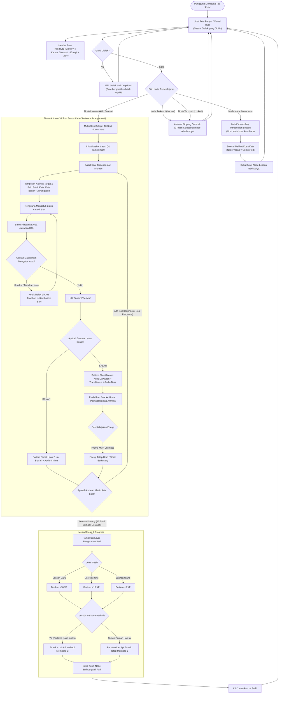

# Product Requirement Document (PRD)

## Document Information

| Item | Detail |
| :--- | :--- |
| **Document ID** | PRD2 |
| **Feature ID** | PATH-L-01, PATH-L-02, PATH-L-03, PATH-L-04, PATH-L-05, PATH-L-06, PATH-L-07 |
| **Feature Name** | Gamified Learning Path ("Rute"), Language Isolation, Header Navigation, Bagian & Unit Structure, Vocabulary Lesson, Sentence Arrangement, Energy Engine, and Daily Streak |
| **Application** | Dhou (تطبيق ضوء) — Mobile Web (PWA) & iOS Native Wrapper (CapacitorJS) |
| **Module** | Gamified Learning Path ("Rute") & Progression Core |
| **Sprint** | Sprint 2 |
| **Epic** | Learning Progression, Gamification & Sentence Builder |
| **Priority** | Critical (P0) |
| **Status** | Approved |
| **Implementation Status** | Planned |
| **Version** | 1.1 |
| **Last Updated** | 2026-11-08 |
| **Product Owner** | Fariz Mirza Abdillah |
| **Dependencies** | PRD1 (User Authentication), Design System (Figma Dhou), Research Reference Mapping (4-Pillar Cycle) |

---

## 1. Business Problem

Dhou adalah platform pembelajaran bahasa Arab adaptif (*Fusha* dan *'Ammiyyah*). Setelah pengguna masuk melalui gerbang autentikasi (PRD1), mereka membutuhkan media latihan bahasa terstruktur (*Structured Language Practice*) yang mengonversi pemahaman pasif dari video menjadi kemampuan kognitif aktif.

Ketiadaan modul *Gamified Learning Path* pada fase ini menimbulkan hambatan kritis:
1. **Disorientasi Alur Belajar & Penurunan Retensi D1–D7**: Pembelajar bahasa Arab mandiri mudah kehilangan arah tanpa peta kurikulum bertahap (*Path Tree*). Ketiadaan struktur jelas memicu kebingungan dan tingginya angka pengguna yang meninggalkan aplikasi (*drop-off*).
2. **Percampuran Jalur Antar Bahasa**: Tanpa isolasi path per bahasa, kemajuan belajar pengguna dari satu bahasa dapat bersinggungan atau tercampur dengan jalur bahasa lain. Hal ini menciptakan kebingungan kurikulum dan data progres yang tidak akurat.
3. **Ketiadaan Hierarki Konten yang Jelas (Bagian & Unit)**: Tanpa struktur *Bagian* (kumpulan Unit tematik) dan *Unit* (kumpulan Lesson + Exercise), pengguna tidak memiliki gambaran kedalaman dan urutan materi. Konten terasa datar dan tidak ada rasa pencapaian bertingkat.
4. **Kelemahan Kuis Konvensional dalam Melatih Sintaksis Arab**: Pembelajaran susunan kalimat (*nahwu* dan pola frasa percakapan) tidak efektif jika hanya diuji dengan pilihan ganda pasif. Dibutuhkan latihan kinestetik berbasis susun kata (*Sentence Arrangement*) yang mendukung ortografi Arab (arah baca kanan-ke-kiri/RTL, harakat lengkap, dan huruf sambung) disertai kata pengecoh (*distractors*) yang menguji ketelitian.
5. **Tidak Ada Jembatan Kosa Kata Sebelum Latihan**: Pengguna langsung dihadapkan pada soal susun kata tanpa terlebih dahulu mengenal kosa kata baru. Hal ini meningkatkan frustrasi dan menurunkan performa sesi pertama. Dibutuhkan *Vocabulary Introduction Lesson* di awal setiap Unit.
6. **Fluktuasi Motivasi Harian Pembelajar**: Konsistensi harian adalah kunci kefasihan bahasa. Tanpa indikator komitmen harian yang tegas seperti **Api Streak (🔥)** dengan aturan yang jelas (minimal 1 sesi tuntas per hari kalender), motivasi belajar pengguna cepat meredup.
7. **Dilema Monetisasi Energi vs Akselerasi Adopsi Pengguna MVP**:
   - Sistem kuota energi (*Energy/Lives*) adalah standar industri penting untuk monetisasi langganan berbayar (*Unlimited Energy*).
   - Namun, membatasi energi pengguna Free Plan (misal: memblokir belajar setelah 5 kali salah) di awal peluncuran MVP akan merusak pengalaman belajar dan menghambat pengujian kurikulum.
   - Diperlukan arsitektur sistem energi yang dirancang matang untuk kebutuhan komersial masa depan, namun memiliki kebijakan khusus MVP yang memberikan **Unlimited Energy bagi pengguna Free Plan** tanpa perlu merombak skema basis data di masa mendatang.

---

## 2. Business Value

- **Peningkatan Retensi Belajar Harian (D7 & D30 Retention)**: Mekanisme visual **Api Streak Harian (🔥)** yang menyala saat menyelesaikan minimal 1 lesson terbukti meningkatkan retensi belajar harian hingga $>40\%$.
- **Penguasaan Sintaksis Aktif Berbasis Gamifikasi**: Latihan **Susun Kata (*Sentence Arrangement*)** dengan tepat 10 butir soal dan 2 kata pengecoh melatih pembelajar membedakan urutan kata subjek-predikat-objek dalam *Fusha* dan ragam lisan *'Ammiyyah* secara aktif dan menyenangkan.
- **Pemberantasan Frustrasi Pengguna via Model MVP Unlimited Energy**: Pengguna bebas mencoba dan belajar tanpa takut terblokir kuota baterai saat peluncuran awal, menciptakan kepuasan pengguna (*high CSAT*) dan ulasan positif aplikasi.
- **Fondasi Monetisasi Masa Depan Siap-Pakai (*Future-Proof Paywall Architecture*)**: Sistem kuota energi didesain sejak awal di level data dan API, sehingga pengaktifan kuota 5 energi harian untuk Free Plan dapat diaktifkan secara instan via *feature flag* saat versi berbayar diluncurkan.
- **Tingkat Penguasaan Materi Penuh (*100% Mastery via Error Re-queuing*)**: Soal yang salah dijawab wajib diulang di akhir sesi hingga benar, menjamin pembelajar benar-benar paham sebelum melangkah ke node berikutnya.

---

## 3. Purpose

Menyediakan modul **Rute** (nama resmi menu pembelajaran di bilah navigasi bawah) pada aplikasi Dhou yang memfasilitasi:
- Visualisasi peta navigasi materi dengan hierarki **Bagian → Unit → Lesson Nodes** per bahasa yang terisolasi (Fusha / 'Ammiyyah, dsb. tidak pernah tercampur).
- Header Rute dengan judul menu **"Rute"** dan **dropdown pemilihan dialek tepat di samping judul** di sisi kiri (`Rute [Mesir 🇪🇬 ▾]`) yang konsisten menggunakan komponen Dropdown di Desktop maupun Mobile, serta indikator **Streak 🔥, Energi ⚡, dan XP ⭐** di sisi kanan.
- **Vocabulary Introduction Lesson** di tiap awal Unit sebagai jembatan kosa kata sebelum sesi latihan.
- **Exercise** di tiap akhir Unit sebagai ujian komprehensif unit tersebut.
- Sesi latihan interaktif penyusunan kalimat berbahasa Arab (*Sentence Arrangement*) sebanyak 10 butir soal dengan 2 kata pengecoh.
- Mekanisme pengulangan soal salah di akhir sesi (*Error Re-queue*), mesin penghitung api streak harian (*Daily Streak Engine*), serta infrastruktur energi cerdas (*Energy Engine*) dengan kebijakan promosi *unlimited energy* di fase MVP.

---

## 4. Objectives

1. Menetapkan nama menu resmi tab belajar sebagai **"Rute"** di bilah navigasi bawah aplikasi Dhou (menggantikan nama lama "Belajar" / "Path").
2. Mengimplementasikan **Isolasi Jalur Belajar per Bahasa**: setiap bahasa (Fusha / 'Ammiyyah Mesir / 'Ammiyyah Syam / dll.) memiliki rute, progres, dan data node yang terpisah secara independen. Data antara bahasa yang berbeda tidak pernah bercampur.
3. Membangun **Header Rute** dengan tata letak:
   - **Kiri**: Judul menu **"Rute"** dengan Dropdown pemilih dialek/bahasa aktif tepat di samping judul (misal: `Rute [Mesir 🇪🇬 ▾]`). Format pilihan bahasa wajib berbentuk komponen **Dropdown** yang seragam baik di desktop maupun mobile.
   - **Kanan**: Tiga indikator pill stats pembelajaran: Api Streak (🔥 + angka), Energi (⚡ ∞ / angka), dan XP (⭐ + total poin).
4. Mendefinisikan dan mengimplementasikan hierarki konten **Bagian → Unit → Lesson/Exercise**:
   - **Bagian** (*Section*): Kelompok tematik besar yang menghimpun beberapa Unit. Contoh: "Bagian 1: Dasar-Dasar Percakapan".
   - **Unit**: Kumpulan Lesson yang berfokus pada satu tema spesifik. Setiap Unit terdiri dari **minimal 3 Lesson + 1 Exercise** di akhir Unit.
   - **Exercise**: Sesi latihan penutup tiap Unit, berisi 10 soal yang menggabungkan kosa kata dari seluruh Lesson dalam Unit tersebut.
5. Mengimplementasikan **Vocabulary Introduction Lesson**: Node pertama di setiap Unit wajib berupa lesson pengenalan kosa kata baru, bukan langsung soal susun kata.
6. Mengimplementasikan peta belajar interaktif (**Visual Learning Path Tree**) dengan hierarki *Bagian $\rightarrow$ Unit $\rightarrow$ Lesson Nodes* yang memiliki 3 status visual jelas: *Terkunci (Locked)*, *Aktif (Active / Current)*, dan *Selesai (Completed)*.
7. Membangun 1 varian latihan kuis utama untuk MVP: **Susun Kata Arab (*Sentence Arrangement*)** dengan parameter:
   - Tepat **10 butir soal** per sesi lesson.
   - Tepat **2 kata pengecoh (*distractors*)** pada setiap soal di baki kata acak (*Word Bank Tray*).
   - Dukungan ortografi Arab RTL (`dir="rtl"`), font Amiri/Noto Sans Arabic dengan harakat lengkap, serta tombol pemutar audio pengucapan.
8. Menerapkan mekanisme **Error Re-queuing (Mastery Loop)**: Soal yang salah dijawab otomatis dipindahkan ke urutan paling belakang sesi kuis dan wajib diselesaikan dengan benar sebelum sesi dinyatakan tuntas.
9. Mengembangkan mesin kalkulasi **Daily Streak (🔥)** otomatis berbasis zona waktu lokal pengguna (`user_timezone`):
   - Minimal menyelesaikan 1 sesi lesson penuh (10 butir soal tuntas) dalam 1 hari kalender lokal (00:00:00 – 23:59:59) untuk menyalakan/mempertahankan api streak.
   - Menampilkan status visual api membara (aktif), redup/abu-abu (berisiko putus), dan padam/reset ke 0 jika terlewat 1 hari penuh.
10. Merancang arsitektur **Energy Engine (🔋)**:
    - Skema model data siap langganan: Free Plan (5 kuota harian) vs Premium Plan (Unlimited $\infty$).
    - Kebijakan Promo MVP: Free Plan mendapatkan status *Unlimited Energy Promo* (jawaban salah tidak memotong energi dan tidak memblokir sesi belajar).
    - Indikator UI di Header menampilkan status energi dengan simbol tak hingga (`⚡ ∞`).
11. Menampilkan layar rangkuman penyelesaian sesi (**Lesson Summary Modal**) dengan perolehan XP (+10 XP untuk sesi baru, +5 XP untuk latihan ulang), persentase akurasi percobaan pertama, animasi perayaan api streak, dan pembukaan kunci node berikutnya di Rute.

---

## 5. Scope

### In Scope

- **Nama Menu Tab Belajar: "Rute"**
  - Nama label pada bilah navigasi bawah (Bottom Navigation Bar) untuk tab modul pembelajaran adalah **"Rute"** — bukan "Belajar", "Path", atau label lainnya.

- **Isolasi Jalur Belajar per Bahasa (PATH-L-00)**
  - Setiap bahasa yang didukung Dhou (Fusha / 'Ammiyyah Mesir / 'Ammiyyah Syam / dll.) memiliki data Rute, struktur Bagian/Unit, Lesson Node, dan rekam progres pengguna yang **terpisah sepenuhnya**.
  - Pengguna hanya dapat melihat dan mengerjakan Rute dari satu bahasa dalam satu tampilan (bahasa yang dipilih via dropdown header).
  - Backend tidak pernah mencampur entri progres lintas bahasa dalam satu query atau tampilan.

- **Header Rute (PATH-L-H)**
  - Tata letak header di halaman Rute (rata dua sisi):
    - **Rata Kiri**: Judul menu **"Rute"** bersanding langsung dengan **Dropdown Pemilih Dialek** (`Rute [Mesir 🇪🇬 ▾]`). Pemilihan dialek wajib menggunakan komponen **Dropdown UI** yang seragam di desktop dan mobile (bukan modal terpisah).
    - **Rata Kanan**: Tiga pill indikator status belajar berurutan:
      1. 🔥 Api Streak + angka hari berturut-turut (misal: `🔥 3`).
      2. ⚡ Energi + angka atau simbol `∞` (misal: `⚡ ∞`).
      3. ⭐ XP + total poin akumulasi pengguna (misal: `⭐ 150`).
  - Header ini persisten (sticky) di bagian atas halaman Rute saat pengguna scroll.


- **Hierarki Konten: Bagian → Unit → Lesson/Exercise (PATH-L-STR)**

  **Definisi Bagian (Section):**
  > Bagian adalah kelompok tematik besar yang menghimpun beberapa Unit yang saling berkaitan secara topik. Setiap Bagian ditandai dengan banner pembatas (*section divider*) di halaman Path. Contoh: *"Bagian 1: Dasar-Dasar Percakapan"*.

  **Definisi Unit:**
  > Unit adalah kumpulan Lesson yang berfokus pada satu tema spesifik dalam Bagian induknya. Contoh: *"Unit 1: Perkenalan & Sapaan Sehari-hari"* di dalam Bagian 1. Setiap Unit memiliki banner Unit di atas jalur node-nya (menampilkan nomor unit, judul, dan indikator progres unit).

  **Aturan Komposisi Unit:**
  - Setiap Unit terdiri dari **minimal 3 Lesson + 1 Exercise** di akhir Unit.
  - Urutan node dalam Unit: `[Vocab Lesson] → [Lesson 2] → [Lesson 3] → … → [Exercise]`
  - Node pertama Unit wajib berupa **Vocabulary Introduction Lesson** (lihat PATH-L-07).
  - Node terakhir Unit wajib berupa **Exercise** (sesi latihan komprehensif unit tersebut).
  - Lesson di antara node pertama dan terakhir adalah lesson latihan susun kata biasa.

  **Definisi Exercise:**
  > Exercise adalah sesi latihan penutup tiap Unit. Berisi **10 soal** yang menggabungkan kosa kata dari seluruh Lesson dalam Unit tersebut. Exercise menggunakan mekanisme kuis yang sama dengan Lesson (Sentence Arrangement + Error Re-queue). Menyelesaikan Exercise memberikan **+15 XP** (lebih tinggi dari Lesson biasa). Exercise hanya terbuka setelah seluruh Lesson dalam Unit selesai.

- **Peta Jalur Belajar / Visual Path (PATH-L-01)**
  - Banner Bagian: Pemisah visual antar Bagian di scroll path. Judul Bagian ditampilkan tebal.
  - Banner Unit: Nomor Unit, Judul Pembelajaran (misal: *Unit 1: Perkenalan & Sapaan Sehari-hari*), dialek target, dan indikator progres unit.
  - Jalur Node Berkelok (Zig-zag Path):
    - *Locked Node*: Berwarna abu-abu, ikon gembok, memicu getaran dan pesan peringatan saat disentuh.
    - *Active Node (Current)*: Berwarna Warm Orange (`#FF8904`), animasi denyut (*pulse glow*), tooltip melayang "Mulai!".
    - *Completed Node*: Berwarna Dialect Blue (`#51A2FF`) dengan ikon centang putih, dapat diakses kembali untuk latihan ulang.
    - *Exercise Node*: Badge berlabel "Exercise" di atas ikon node untuk membedakannya dari Lesson biasa.
    - *Vocab Node*: Badge berlabel "Kosa Kata" di atas ikon node pertama tiap Unit.
  - Fitur *Auto-scroll Viewport*: Otomatis memusatkan layar ke node aktif saat halaman dimuat.
- **Sesi Latihan Susun Kata / Sentence Arrangement (PATH-L-02)**
  - Header kuis: Tombol keluar (X) dengan konfirmasi batal, Progress Bar persentase penyelesaian 10 soal, dan badge energi tak terbatas.
  - Kartu Soal:
    - Instruksi Bahasa Indonesia: *"Susun kalimat ini ke dalam bahasa Arab"*.
    - Kalimat target arti (contoh: *"Halo, selamat pagi"*).
    - Label variasi dialek (*Fusha* / *Ammiyyah Mesir* / *Ammiyyah Syam*).
    - Tombol audio penutur asli untuk mendengarkan pelafalan kalimat.
  - Area Susun Kalimat (*Answer Drop Zone*):
    - Kontainer RTL dengan placeholder garis bawah atau slot balok.
    - Mengetuk kata di Word Bank akan memindahkan balok ke Answer Zone secara berurutan.
    - Mengetuk balok di Answer Zone akan mengembalikannya ke posisi semula di Word Bank.
  - Wadah Balok Kata (*Word Bank Tray*):
    - Berisi balok kata pembentuk kalimat benar ditambah **tepat 2 kata pengecoh (*distractor tiles*)**.
    - Balok kata berharakat lengkap dan diacak susunannya (*shuffled*) setiap kali soal dimuat.
    - Balok yang sudah dipilih berubah menjadi slot transparan (*ghost placeholder*).
  - Validasi & Umpan Balik:
    - Tombol "Periksa" aktif jika minimal 1 balok telah disusun di Answer Zone.
    - Jawaban Benar: Lembar bawah hijau (`#22C55E`), bunyi nada sukses (*chime*), tombol "Lanjut".
    - Jawaban Salah: Lembar bawah merah (`#EF4444`), nada koreksi (*buzz*), menampilkan kunci jawaban tepat + transliterasi, tombol "Mengerti".
- **Mekanisme Antrean & Pengulangan Soal Salah (PATH-L-03)**
  - Antrean kuis awal berisi 10 soal: $[Q_1, Q_2, \dots, Q_{10}]$.
  - Jika soal $Q_k$ dijawab salah, soal dipindahkan ke ekor antrean kuis (*re-queued to the end*).
  - Soal yang diulang diacak kembali susunan balok katanya saat muncul di akhir sesi.
  - Sesi kuis hanya dinyatakan selesai jika antrean soal telah kosong ($0$ soal tersisa).
  - Menghitung akurasi berbasis percobaan pertama (*first-attempt accuracy*).
- **Mesin Energi Fleksibel & Kebijakan MVP Unlimited (PATH-L-04)**
  - Atribut basis data: `energy_count`, `max_energy` (default 5), `is_unlimited_energy`, `last_energy_refill_at`.
  - Feature Flag MVP: `ENV_MVP_UNLIMITED_ENERGY = true`.
  - Pada mode MVP: Jawaban salah **tidak memotong kuota energi**. Tidak ada batasan sesi belajar harian.
  - Visual Top Bar: Ikon baterai/petir dengan simbol tak hingga `⚡ ∞` dan dialog info promo MVP.
  - Logika arsitektur siap-pakai: Saat flag dimatikan pasca-MVP, sistem otomatis beralih ke aturan 5 energi, refill 1 energi per 4 jam, dan pemblokiran saat energi = 0.
- **Mesin Api Streak Harian / Daily Streak Engine (PATH-L-05)**
  - Penentuan hari kalender berbasis zona waktu lokal pengguna (`user_timezone`, contoh: `Asia/Jakarta`).
  - Syarat aktivasi: Menyelesaikan minimal **1 sesi lesson penuh (10 butir soal tuntas)** dalam rentang 00:00:00 – 23:59:59 waktu lokal.
  - Status Streak:
    - *Aktif Hari Ini (Active)*: Api menyala terang oranye-kuning beranimasi, counter bertambah +1 (maksimal 1 kali per hari).
    - *Pending / Berisiko (At Risk)*: Pengguna menyelesaikan kemarin tapi belum hari ini. Api berwarna abu-abu redup.
    - *Padam / Reset (Broken)*: Pengguna melewati satu hari kalender penuh tanpa belajar. Streak direset ke 0.
- **Layar Rangkuman Sesi / Lesson Summary (PATH-L-06)**
  - Tampilan modal pasca-soal terakhir selesai:
    - Banner apresiasi keberhasilan (*"Sesi Selesai! Kamu Hebat!"*).
    - Perolehan XP: **+10 XP** untuk lesson baru, **+5 XP** untuk latihan ulang (*review*).
    - Persentase akurasi pengerjaan.
    - Animasi ledakan api streak (*flame burst*) saat lesson pertama hari ini selesai.
    - Tombol "Lanjutkan ke Path" yang otomatis membuka kunci node berikutnya.

### Out of Scope

- Varian kuis selain Susun Kata (seperti *Listen and Choose*, *Fill in the Blank*, *Record-and-Compare*, *Voice Shadowing* disimpan untuk Sprint 3 & 4).
- Pembelian koin atau item pelindung streak (*Streak Freeze*) di toko (*Shop*) (direncanakan pasca-MVP).
- Pengurangan kuota energi riil dan gerbang pembayaran langganan *Dhou Super / Unlimited Energy* (UI & skema disiapkan, pemotongan kuota dinonaktifkan di MVP).
- Fitur leaderboard sosial dan liga mingguan antar-pengguna (disimpan untuk rilis v2.0).

---

## 6. User Persona

### Persona 1: Rian (24 Tahun) – Pembelajar Mandiri Pemula
- **Karakteristik**: Mahasiswa tingkat akhir yang sedang mempersiapkan diri bekerja di kawasan Timur Tengah.
- **Tujuan**: Memahami susunan kalimat percakapan praktis secara bertahap tanpa harus menghafal rumus tata bahasa teoritis yang rumit.
- **Pain Points**: Mudah bosan dengan teks statis buku pelajaran, sering putus belajar jika tidak ada pemicu konsistensi harian, dan frustrasi jika baru salah menjawab 2 kali langsung dilarang belajar karena kehabisan baterai/energi.
- **Ekspektasi di Dhou**: Jalur belajar terstruktur seperti game, latihan balok kata Arab yang responsif di layar ponsel, api streak yang membakar semangat harian, serta kebebasan mencoba sepuasnya tanpa takut kehabisan energi di masa awal belajar.

### Persona 2: Sarah (29 Tahun) – Profesional Sibuk & Pembelajar Konsisten
- **Karakteristik**: Karyawan swasta yang hanya memiliki waktu luang 10–15 menit di sela-sela perjalanan komuter atau menjelang tidur malam.
- **Tujuan**: Membangun kebiasaan harian (*daily habit*) belajar bahasa Arab secara disiplin.
- **Pain Points**: Kecewa berat jika streak belajarnya hangus akibat inkonsistensi zona waktu server. Kehilangan arah jika materi yang dipelajari terlalu panjang dan tidak tuntas.
- **Ekspektasi di Dhou**: Kepastian sesi yang ringkas (1 lesson = 10 soal), indikator api streak yang transparan di bilah atas, dan kejelasan bahwa menyelesaikan 1 lesson per hari sudah cukup untuk menjaga api belajarnya tetap menyala.

---

## 7. User Flow & Navigation Diagram

Berikut adalah alur perjalanan pengguna dari pemilihan dialek di header **Rute**, melalui Vocabulary Lesson, pengerjaan 10 soal susun kata, penanganan antrean soal salah, hingga aktivasi Api Streak dan pembukaan kunci node berikutnya:



---

## 8. Feature Specifications per User Story

### US-PATH-01: Navigasi Visual Path & Node Belajar

| Attribute | Specification |
| :--- | :--- |
| **User Story ID** | US-PATH-01 |
| **Feature ID** | PATH-L-01 |
| **Title** | Visual Learning Path Tree & Progression Navigation |
| **Priority** | Critical (P0) |
| **Description** | Sebagai pembelajar bahasa Arab, saya ingin melihat peta jalur belajar (*Learning Path Tree*) dengan visualisasi node berkelok dan status yang jelas (Selesai, Aktif, Terkunci) per unit agar saya memahami posisi dan arah kemajuan belajar saya. |

#### User Journey
1. Pengguna mengetuk tab **"Rute"** pada bilah navigasi bawah (*Bottom Navigation Bar*).
2. Header Rute tampil dengan judul **"Rute"** dan **dropdown pemilih dialek** tepat di samping judul di sisi kiri (`Rute [Mesir 🇪🇬 ▾]`), serta tiga pill status pembelajaran di sisi kanan: **Streak 🔥, Energi ⚡, XP ⭐**.
3. Di bawah header, Rute menampilkan konten berurutan: Banner Bagian (misal: *"Bagian 1: Dasar-Dasar Percakapan"*), lalu Banner Unit (misal: *"Unit 1: Perkenalan & Sapaan Sehari-hari"*), diikuti jalur zig-zag node.
4. Node pertama Unit ditandai badge **"Kosa Kata"** (Vocabulary Lesson), node terakhir Unit ditandai badge **"Exercise"**.
5. Pengguna melihat node aktif saat ini memiliki efek lingkaran berdenyut (*subtle pulse glow*) berwarna Warm Orange (`#FF8904`) dengan tooltip melayang bertuliskan "Mulai!".
6. Node-node sebelum node aktif ditandai lingkaran biru/hijau dengan ikon centang putih menandakan telah selesai (*Completed*).
7. Node-node setelah node aktif berwarna abu-abu redup dengan ikon gembok terkunci (*Locked*).
8. Pengguna mengetuk node aktif untuk memulai sesi belajar.

#### Acceptance Criteria
- **AC-PATH-01-A (Menu Name):** Nama label tab di bilah navigasi bawah wajib menampilkan teks **"Rute"**.
- **AC-PATH-01-B (Header Layout):** Header halaman Rute wajib menampilkan:
  - Sisi kiri: Judul menu **"Rute"** bersanding langsung dengan **Dropdown Pemilih Dialek** aktif (misal: `Rute [Mesir 🇪🇬 ▾]`). Format antarmuka wajib berbentuk **Dropdown** baik pada layar desktop maupun mobile.
  - Sisi kanan: Tiga pill status pembelajaran berurutan (kiri ke kanan): Streak 🔥 + angka, Energi ⚡ + nilai/`∞`, XP ⭐ + total poin.
  - Header sticky: tetap terlihat dan persisten saat pengguna scroll ke bawah.
- **AC-PATH-01-C (Dialect Isolation):** Saat pengguna mengganti dialek/bahasa di dropdown:
  - Halaman Rute wajib me-render ulang struktur Bagian/Unit/Node sesuai dialek yang dipilih.
  - Data progres yang ditampilkan harus milik rute dialek tersebut, tidak tercampur dengan dialek lain.
- **AC-PATH-01-D (Section & Unit Banners):** Sistem wajib merender banner Bagian (*Section divider*) dan banner Unit secara terpisah di halaman Rute. Banner Bagian muncul sebelum Unit pertama dari Bagian tersebut.
- **AC-PATH-01-E (Visual Layout):** Sistem wajib merender tata letak pohon kurikulum berurutan dari atas ke bawah dengan posisi horizontal zig-zag yang proporsional pada resolusi mobile (360px–430px).
- **AC-PATH-01-F (Node States):** Setiap node wajib mencerminkan satu dari tiga status valid:
  - `COMPLETED`: Lingkaran penuh warna Dialect Blue (`#51A2FF`), ikon centang putih, dapat diklik untuk sesi latihan ulang (+5 XP).
  - `CURRENT`: Lingkaran warna Warm Orange (`#FF8904`), beranimasi denyut (*pulsing halo*), tooltip "Mulai!", dapat diklik untuk memulai sesi baru (+10 XP).
  - `LOCKED`: Lingkaran abu-abu `#D1D5DB`, ikon gembok `#9CA3AF`, tidak dapat diklik untuk memulai sesi baru.
- **AC-PATH-01-G (Node Type Badges):** Node pertama tiap Unit wajib memiliki badge "Kosa Kata" (Vocabulary Lesson). Node terakhir tiap Unit wajib memiliki badge "Exercise". Badge ini tampil di atas lingkaran node.
- **AC-PATH-01-H (Locked Click Feedback):** Jika pengguna mengetuk node berstatus `LOCKED`, sistem wajib memunculkan animasi goyang (*shake animation*) pada gembok disertai pesan toast: *"Selesaikan pelajaran sebelumnya terlebih dahulu untuk membuka kunci materi ini."*
- **AC-PATH-01-I (Auto-scroll to Active):** Posisi scroll viewport halaman Rute wajib otomatis memusatkan tampilan (*auto-scroll into view*) ke node berstatus `CURRENT` saat halaman pertama kali dimuat.

#### UI Specification Table

| UI Component | Spec / Token | Visual State | Interaction Behavior |
| :--- | :--- | :--- | :--- |
| **Rute Header** | Height: `56px`, Bg: `#FFFFFF` atau surface token, Border bottom: `1px solid #F3F4F6`, Sticky | Sticky saat scroll | Kiri: Judul "Rute" + Dropdown dialek `[Mesir 🇪🇬 ▾]`; Kanan: Pill Streak 🔥, Energi ⚡, XP ⭐ |
| **Dialect Dropdown** | Pill trigger di samping judul "Rute", Bg: `#FFF7ED`, Border: `#FFEDD5`, Radius: `9999px`, Text: Fredoka Medium `14px` | Aktif / Terpilih | Mengetuk membuka menu dropdown daftar dialek (Desktop & Mobile); pergantian dialek memuat ulang Rute |
| **Section Divider Banner** | Full-width, Bg: `#F9FAFB`, Border top/bottom `1px solid #E5E7EB`, Text: Fredoka SemiBold `13px` UPPERCASE, Color: `#6B7280` | Standar | Pemisah visual antar Bagian di scroll path |
| **Unit Banner Card** | Bg: `#FF8904`, Radius: `16px`, Padding: `16px`, Text: Fredoka Bold | Standar | Sticky saat scroll melewati unit, memuat judul unit, dialek target, dan indikator progres unit |
| **Active Node Button** | Diameter: `68px`, Bg: `#FF8904`, Border bottom: `4px solid #D67000` (3D Button Dhou), Radius: `9999px` | Current (Pulsing) | Animasi *scale 0.96* saat disentuh, membuka modal dialog pra-sesi kuis |
| **Completed Node** | Diameter: `60px`, Bg: `#51A2FF`, Border bottom: `4px solid #2B7CD4`, Ikon: Checkmark putih | Completed | Membuka modal konfirmasi latihan ulang (+5 XP) |
| **Locked Node** | Diameter: `60px`, Bg: `#E5E7EB`, Border bottom: `4px solid #D1D5DB`, Ikon: Gembok abu-abu | Disabled / Locked | Animasi getar (*shake 0.3s*) + haptic error saat disentuh |
| **Node Type Badge** | Pill di atas node, Bg: `#FEF3C7` (Vocab) / `#EFF6FF` (Exercise), Font: `10px`, Radius: `9999px` | Standar | Informatif, tidak interaktif |
| **Path Connectors** | Garis lengkung SVG / dashed line, tebal `6px`, warna: `#FED7AA` (aktif) atau `#E5E7EB` (terkunci) | Background | Menghubungkan titik tengah antar-lingkaran node secara berkesinambungan |

---

### US-PATH-02: Latihan Interaktif Susun Kata (Sentence Arrangement)

| Attribute | Specification |
| :--- | :--- |
| **User Story ID** | US-PATH-02 |
| **Feature ID** | PATH-L-02 |
| **Title** | Arabic Sentence Arrangement with Exactly 2 Distractors |
| **Priority** | Critical (P0) |
| **Description** | Sebagai pembelajar bahasa Arab, saya ingin menyusun kata-kata acak berbahasa Arab (*Fusha* / *'Ammiyyah*) menjadi kalimat yang benar dengan tata letak RTL, tombol balok interaktif, dan tepat 2 kata pengecoh agar saya memahami struktur kalimat secara kontekstual dan kinestetik. |

#### User Journey
1. Pengguna masuk ke dalam sesi latihan dari node aktif. Sesi memuat total **10 butir soal**.
2. Di bagian atas layar, progress bar menunjukkan posisi penyelesaian soal (contoh: Soal 1 dari 10).
3. Pengguna membaca instruksi dalam bahasa Indonesia: *"Susun kalimat bahasa Arab berikut:"* disertai kalimat target: *"Halo, nama saya Ahmad"*.
4. Terdapat badge variasi dialek: `Fusha (الفصحى)` atau `Mesir (مصر)`.
5. Pengguna mengetuk tombol audio speaker untuk mendengarkan pengucapan kalimat utuh oleh penutur asli.
6. Di area bawah (*Word Bank Tray*), sistem menampilkan balok-balok kata Arab berharakat acak: kata pembentuk kalimat benar ditambah **tepat 2 kata pengecoh (*distractor tiles*)**.
7. Pengguna mengetuk balok `[مرحباً]` $\rightarrow$ balok meluncur ke posisi pertama di kotak jawaban (*Answer Drop Zone*) dengan alur baca kanan-ke-kiri (RTL).
8. Pengguna mengetuk balok `[اسمي]` lalu `[أحمد]`. Ketiga balok tersusun rapi di area jawaban. Dua balok kata pengecoh tetap tertinggal di baki.
9. Jika pengguna salah memilih, pengguna cukup mengetuk balok di area jawaban untuk mengembalikannya ke baki asal.
10. Pengguna menekan tombol "Periksa".
11. Sistem memvalidasi urutan kata:
    - Jika benar: Lembar bawah hijau muncul, suara denting sukses dimainkan, tombol berubah menjadi "Lanjut".
    - Jika salah: Lembar bawah merah muncul, getaran haptic error aktif, sistem menampilkan kunci jawaban yang benar dan transliterasi latin, tombol menjadi "Mengerti". Soal tersebut otomatis diantrekan ulang ke giliran akhir sesi.

#### Acceptance Criteria
- **AC-PATH-02-A (Question Count):** Setiap sesi lesson wajib memiliki tepat **10 butir soal** susun kata.
- **AC-PATH-02-B (Distractor Count):** Baki kata acak (*Word Bank Tray*) pada setiap butir soal wajib menyertakan **tepat 2 kata pengecoh (*distractors*)** yang memiliki kemiripan morfologis atau semantis namun salah dalam konteks kalimat tersebut.
- **AC-PATH-02-C (RTL & Diacritics Display):** Balok kata Arab wajib menggunakan arah baca teks `dir="rtl"`, jenis huruf Amiri atau Noto Sans Arabic dengan *line-height* $\ge 1.7$ agar seluruh harakat (fathah, kasrah, dhommah, tanwin, sukun, tasydid) tampil utuh dan jelas.
- **AC-PATH-02-D (Bidirectional Tap Toggle):**
  - Mengetuk balok di Word Bank $\rightarrow$ memindahkan balok ke posisi paling akhir urutan RTL di Answer Zone.
  - Mengetuk balok di Answer Zone $\rightarrow$ mengembalikan balok ke slot asalnya di Word Bank secara instan dengan animasi transisi $<150\text{ ms}$.
- **AC-PATH-02-E (Check Button State):** Tombol "Periksa" wajib berstatus *disabled* (abu-abu, tidak dapat diklik) selama Area Jawaban belum terisi minimal 1 balok kata.

#### UI Specification Table

| UI Component | Spec / Token | Visual State | Interaction Behavior |
| :--- | :--- | :--- | :--- |
| **Top Progress Bar** | Height: `12px`, Bg track: `#E5E7EB`, Fill: `#22C55E`, Radius: `9999px` | Dynamic Width | Bertambah secara proporsional sesuai rasio soal yang diselesaikan dengan benar |
| **Target Sentence Prompt** | Font: Fredoka SemiBold, Size: `18px`, Color: `#1F2937` | Standar | Menampilkan arti kalimat dalam Bahasa Indonesia yang harus diterjemahkan |
| **Arabic Variety Badge** | Pill badge, Bg: `#EFF6FF`, Border: `#BFDBFE`, Text: `#1D4ED8`, Size: `12px` | Standar | Menampilkan dialek target (Fusha / Mesir / Syam) |
| **Answer Drop Zone** | Min-height: `110px`, Border: `2px dashed #D1D5DB`, Bg: `#F9FAFB`, Radius: `16px`, Padding: `12px` | RTL Flexbox (`dir="rtl"`) | Menampung balok kata terpilih; jika kosong menampilkan garis placeholder abu-abu |
| **Word Bank Tile** | Bg: `#FFFFFF`, Border: `2px solid #E5E7EB`, Shadow: `0 3px 0 #D1D5DB`, Radius: `12px`, Font: Amiri Bold `20px` | Normal / Ghost Slot | Mengetuk tile normal memindahkannya ke Drop Zone; tile yang terpilih menjadi slot transparan (*opacity 0.2*) |
| **Action Bottom Sheet** | Success: `#DCFCE7` (Text `#15803D`); Danger: `#FEE2E2` (Text `#B91C1C`), Radius top: `24px` | Muncul dari bawah (*slide-up 0.25s*) | Menampilkan ikon status, teks evaluasi, kunci jawaban, dan tombol navigasi aksi |

---

### US-PATH-03: Mekanisme Pengulangan Soal Salah (Error Re-queuing)

| Attribute | Specification |
| :--- | :--- |
| **User Story ID** | US-PATH-03 |
| **Feature ID** | PATH-L-03 |
| **Title** | Personalized Error Re-queue & Mastery Loop |
| **Priority** | Critical (P0) |
| **Description** | Sebagai pembelajar, jika saya salah menyusun kalimat, saya ingin soal tersebut diulang kembali di akhir sesi kuis agar saya dapat memperbaikinya dan benar-benar menguasai materi sebelum sesi dinyatakan selesai. |

#### User Journey
1. Pengguna sedang mengerjakan soal ke-3 dari 10 soal ($Q_3$).
2. Pengguna salah menyusun kata dan menekan tombol "Periksa".
3. Sistem memunculkan lembar bawah merah, memperdengarkan suara buzz, dan menyajikan kunci jawaban yang benar.
4. Pengguna menekan tombol "Mengerti".
5. Di balik layar, sistem **tidak menggugurkan soal $Q_3$**, melainkan memindahkannya ke antrean paling akhir sesi ($Q_3$ akan muncul kembali setelah soal ke-10 selesai).
6. Sistem mencatat 1 kesalahan untuk perhitungan metrik akurasi.
7. Pengguna melanjutkan mengerjakan soal $Q_4$ hingga $Q_{10}$.
8. Setelah soal $Q_{10}$ selesai, sistem secara otomatis menampilkan kembali soal $Q_3$. Susunan balok kata di baki diacak ulang.
9. Pengguna menyusun kalimat $Q_3$ dengan benar dan menekan "Periksa".
10. Antrean kuis kini telah bersih (0 soal tersisa). Sistem mengarahkan pengguna ke layar rangkuman (*Lesson Summary*).

#### Acceptance Criteria
- **AC-PATH-03-A (Re-queue Mechanism):** Setiap butir soal yang dijawab salah wajib dimasukkan ke ekor antrean aktif sesi latihan (*pushed to the back of the queue*).
- **AC-PATH-03-B (Shuffle on Repeat):** Saat soal yang di-requeue dimuat kembali ke layar, posisi balok kata (termasuk 2 kata pengecoh) wajib diacak ulang posisinya (*re-shuffled*) untuk mencegah penghafalan posisi visual semata.
- **AC-PATH-03-C (Completion Prerequisite):** Sesi lesson HANYA DAPAT dinyatakan selesai (*Completed*) jika antrean soal telah benar-benar kosong ($0$ soal tersisa).
- **AC-PATH-03-D (First-Attempt Accuracy Formula):** Nilai akurasi sesi dihitung secara objektif menggunakan rumus:
  $$\text{Akurasi} = \left(\frac{10}{10 + \text{Jumlah Total Kesalahan}}\right) \times 100\%$$

---

### US-PATH-04: Sistem Energi & Kebijakan Promo MVP Unlimited

| Attribute | Specification |
| :--- | :--- |
| **User Story ID** | US-PATH-04 |
| **Feature ID** | PATH-L-04 |
| **Title** | Energy Quota Engine & MVP Unlimited Energy Policy |
| **Priority** | High (P1) |
| **Description** | Sebagai pembelajar, saya ingin sistem energi yang adil di mana status energi ditampilkan di bar atas, dengan kuota unlimited di masa MVP untuk eksplorasi tanpa batas, namun memiliki fondasi arsitektur siap-transisi ke energi harian (5 hati) bagi Free Plan dan unlimited untuk Pelanggan Berbayar di masa depan. |

#### User Journey
1. Pengguna melihat bilah atas (*Top Bar*) aplikasi pada halaman utama Path maupun di dalam kuis.
2. Terdapat ikon petir/baterai energi berwarna hijau dengan simbol tak hingga: **`⚡ ∞`**.
3. Pengguna mengetuk ikon energi untuk memeriksa detail kuotanya.
4. Sistem membuka modal dialog: *"Promo Peluncuran MVP: Energi Tanpa Batas! Kamu bebas belajar dan berlatih bahasa Arab sepuasnya tanpa khawatir kehabisan energi."*
5. Selama pengerjaan 10 butir soal, saat pengguna menjawab salah, sistem mencatat kesalahan di antrean kuis namun **tidak memotong kuota energi**. Pengguna tidak pernah mengalami sesi terhenti atau terkunci karena alasan kehabisan energi selama fase MVP.
6. Di balik layar, arsitektur database dan service backend tetap menyimpan struktur data `energy_count`, `max_energy: 5`, `is_unlimited_energy: true`, sehingga siap dialihkan ke model komersial pasca-MVP.

#### Acceptance Criteria
- **AC-PATH-04-A (Data Model Completeness):** Entitas profil pengguna wajib menyimpan field persisten:
  - `energy_count` (Integer, default 5).
  - `max_energy` (Integer, default 5).
  - `is_unlimited_energy` (Boolean, default `true` pada konfigurasi MVP).
  - `last_energy_refill_at` (Timestamp with timezone).
- **AC-PATH-04-B (MVP Unlimited Operation):** Selama variabel sistem `ENV_MVP_UNLIMITED_ENERGY = true`:
  - Kesalahan menjawab soal kuis **tidak boleh** mengurangi nilai `energy_count` di bawah 1.
  - Layar "Kehabisan Energi" (*Out of Energy Modal*) **tidak boleh** dimunculkan.
  - Pengguna bebas memulai sesi latihan berapa kali pun dalam sehari tanpa batasan kuota.
- **AC-PATH-04-C (Post-MVP Paywall Readiness):** Logika verifikasi energi di backend wajib memiliki percabangan kondisional siap-pakai:
  ```typescript
  if (!user.is_unlimited_energy && !config.MVP_UNLIMITED_PROMO) {
    if (user.energy_count <= 0) throw new InsufficientEnergyError();
  }
  ```
- **AC-PATH-04-D (Top Bar Representation):** Ikon energi di Top Bar wajib merender simbol `⚡ ∞` dengan aksen warna hijau cerah (`#22C55E`) untuk memberikan ketenangan pikiran kepada pengguna baru.

#### UI Specification Table

| UI Component | Spec / Token | Visual State | Interaction Behavior |
| :--- | :--- | :--- | :--- |
| **Top Bar Energy Pill** | Pill frame, Bg: `#F0FDF4`, Border: `1.5px solid #BBF7D0`, Padding: `6px 12px`, Radius: `9999px` | Standar | Menampilkan ikon baterai hijau + simbol tak hingga `∞`; jika diklik membuka Modal Info Energi |
| **Energy Info Modal** | Modal dialog tengah, Radius: `24px`, Ilustrasi baterai berpetir | Pop-up Center | Menjelaskan status akun (MVP Unlimited Promo) dan rencana benefit langganan premium di masa depan |
| **Energy Refill Timer (Future-Ready)** | Teks abu-abu `12px`, label: *"Isi ulang penuh dalam 4j 00m"* | Tersembunyi di MVP / Muncul saat post-MVP | Menghitung mundur waktu pengisian 1 energi berikutnya secara otomatis |

---

### US-PATH-05: Aktivasi & Pemeliharaan Api Streak Harian (Daily Streak Engine)

| Attribute | Specification |
| :--- | :--- |
| **User Story ID** | US-PATH-05 |
| **Feature ID** | PATH-L-05 |
| **Title** | Daily Streak Counter & Flame Activation Engine |
| **Priority** | Critical (P0) |
| **Description** | Sebagai pembelajar, saya ingin streak harian saya bertambah dan api streak menyala membara setiap kali saya menyelesaikan minimal 1 lesson (10 butir soal tuntas) dalam 1 hari kalender lokal, agar saya termotivasi membangun kebiasaan belajar harian yang konsisten. |

#### User Journey
1. **Kondisi Awal (Pagi Hari / Belum Belajar):**
   - Pengguna membuka Dhou. Di Top Bar, ikon api streak berstatus redup/abu-abu (`#9CA3AF`) dengan angka streak kemarin (misal: 3).
   - Terdapat label pengingat: *"Selesaikan 1 pelajaran hari ini untuk menjaga apimu menyala!"*.
2. **Menyelesaikan Lesson:**
   - Pengguna memilih node aktif dan menyelesaikan seluruh 10 soal kuis susun kata hingga antrean tuntas.
3. **Momen Aktivasi (Flame Burst):**
   - Layar rangkuman sesi terbuka.
   - Sistem mendeteksi bahwa ini adalah lesson pertama yang diselesaikan pengguna pada tanggal kalender lokal hari ini (`current_date`).
   - Counter streak bertambah dari 3 menjadi 4.
   - Animasi partikel api membara (*flame burst animation*) meledak di layar dengan efek suara perayaan (*celebration fanfare*).
   - Label status berubah menjadi: *"Api Streak Menyala! Kamu konsisten 4 hari berturut-turut! 🔥"*.
4. **Kunjungan Berikutnya di Hari yang Sama:**
   - Ikon api di Top Bar tetap berwarna oranye terang menyala (`#FF8904`).
   - Menyelesaikan lesson ke-2 atau ke-3 di hari yang sama tetap memberikan XP, namun angka streak tidak bertambah ganda (+0 streak, status tetap aktif).

#### Acceptance Criteria
- **AC-PATH-05-A (Minimum Engagement Requirement):** Kriteria valid untuk menyalakan/mempertahankan streak adalah penyelesaian minimal **1 sesi lesson penuh (10 butir soal tuntas)**. Membuka aplikasi saja atau keluar di tengah sesi kuis tidak menyalakan streak.
- **AC-PATH-05-B (Local Timezone Determination):** Perhitungan pergantian hari wajib mengacu pada zona waktu lokal pengguna (`user_timezone`, contoh: `Asia/Jakarta` / UTC+7):
  - Batas hari dimulai pukul `00:00:00` dan berakhir pukul `23:59:59` waktu lokal.
- **AC-PATH-05-C (Streak Increment Logic):**
  - Jika `last_lesson_completed_at` terjadi pada **hari kemarin** ($T - 1\text{ hari}$): Streak bertambah `+1` (`current_streak = current_streak + 1`).
  - Jika `last_lesson_completed_at` terjadi pada **hari ini** ($T$): Streak tidak bertambah lagi, status `streak_active_today = true`.
  - Jika `last_lesson_completed_at` terjadi sebelum kemarin ($T - 2\text{ hari}$ atau lebih lama): Streak dinyatakan patah/hangus, direset menjadi `1` (memulai streak baru hari ini).
- **AC-PATH-05-D (Max Once per Day):** Counter streak hanya berinkremen maksimal `+1` per hari kalender lokal, terlepas dari berapa banyak lesson yang diselesaikan pada hari tersebut.
- **AC-PATH-05-E (Visual Indicator States):**
  - `STREAK_ACTIVE`: Ikon api oranye gradasi merah `#FF5722` - `#FF8904`, angka kontras, efek aura berpendar.
  - `STREAK_AT_RISK`: Ikon api abu-abu garis luar `#9CA3AF`, angka redup, indikasi visual butuh aksi belajar.

#### UI Specification Table

| UI Component | Spec / Token | Visual State | Interaction Behavior |
| :--- | :--- | :--- | :--- |
| **Top Bar Streak Pill** | Pill frame, Bg: `#FFF7ED`, Border: `1.5px solid #FFEDD5`, Radius: `9999px` | Active (Orange) / Inactive (Gray) | Menampilkan ikon api 🔥 + angka hari; jika diklik membuka Modal Kalender Streak |
| **Flame Celebration Canvas** | Lottie / CSS Keyframe Animation, diameter: `140px`, Efek percikan api | Pop-up saat lesson pertama selesai | Menampilkan ledakan api oranye-kuning, angka streak melompat naik (+1) dengan haptic impact |
| **Streak Calendar Modal** | Kalender 7 hari mingguan (Senin–Minggu), lingkaran bertanda centang api | Pop-up Center | Menampilkan riwayat hari-hari aktif belajar dalam minggu berjalan |

---

### US-PATH-06: Layar Rekapitulasi Sesi Belajar & Progresi (Lesson Summary)

| Attribute | Specification |
| :--- | :--- |
| **User Story ID** | US-PATH-06 |
| **Feature ID** | PATH-L-06 |
| **Title** | Lesson Summary, XP Rewarding & Sequential Progression |
| **Priority** | High (P1) |
| **Description** | Sebagai pembelajar, setelah menyelesaikan 10 butir soal, saya ingin melihat layar rangkuman pencapaian dengan animasi perayaan streak, perolehan XP, dan tombol lanjut yang otomatis membuka kunci node berikutnya di Path. |

#### User Journey
1. Pengguna berhasil menjawab soal terakhir dalam antrean kuis.
2. Layar transisi berganti mulus menampilkan modal layar penuh *Lesson Completed*.
3. Sistem menyajikan ringkasan performa:
   - Judul Apresiasi: *"Luar Biasa!"* atau *"Pelajaran Selesai!"*.
   - Kartu Total XP: `+10 XP` untuk materi baru (atau `+5 XP` untuk latihan ulang materi yang sudah selesai).
   - Kartu Akurasi: Persentase jawaban benar percobaan pertama (misal: `100% Sempurna` atau `85% Mantap`).
   - Kartu Status Api Streak: Tampilan api berkobar dengan info streak hari ini.
4. Pengguna menekan tombol primer besar: *"Lanjutkan"*.
5. Sistem mengarahkan pengguna kembali ke halaman utama Path.
6. Pada tampilan Path, node yang baru diselesaikan berubah menjadi status `COMPLETED`, garis konektor menyala, dan node berikutnya berubah status menjadi `CURRENT` (*Mulai!*) dengan animasi pembukaan kunci yang memuaskan.

#### Acceptance Criteria
- **AC-PATH-06-A (Data Persistence):** Menampilkan layar rangkuman wajib memicu pengiriman payload penyelesaian sesi ke backend:
  - Menyimpan record di tabel riwayat penyelesaian lesson (`user_lesson_progress`).
  - Menambahkan akumulasi poin XP ke profil pengguna (`total_xp = total_xp + 10` untuk materi baru, `total_xp = total_xp + 5` untuk pengulangan).
  - Mengupdate status node di basis data sehingga progres tersimpan permanen di cloud.
- **AC-PATH-06-B (Sequential Unlocking):** Node $N+1$ hanya akan terbuka kuncinya (*status CURRENT*) setelah Node $N$ berstatus `COMPLETED`.
- **AC-PATH-06-C (Session Abandonment):** Jika pengguna keluar di tengah pengerjaan (sebelum 10 soal tuntas), progres sesi dibatalkan. Tidak ada XP yang diberikan, streak tidak bertambah, dan node berikutnya tetap terkunci.

#### UI Specification Table

| UI Component | Spec / Token | Visual State | Interaction Behavior |
| :--- | :--- | :--- | :--- |
| **Summary Header** | Teks Fredoka Bold `26px`, Color: `#FF8904`, Ilustrasi maskot lentera Dhou tersenyum | Standar | Menghadirkan rasa pencapaian psikologis yang hangat |
| **Stat Metric Box (XP)** | Bg: `#FEF3C7`, Border: `#FDE68A`, Radius: `16px`, Icon: Bintang emas | Standar | Menampilkan penambahan `+10 XP` atau `+5 XP` dengan animasi angka berputar |
| **Stat Metric Box (Accuracy)**| Bg: `#DCFCE7`, Border: `#BBF7D0`, Radius: `16px`, Icon: Target bullseye | Standar | Menampilkan persentase ketepatan susunan kata pengguna |
| **Continue Button** | 3D Button khas Dhou, Bg: `#FF8904`, Border bottom: `4px solid #D67000`, Width: `100%`, Text: Fredoka Bold `18px` | Normal / Active pressed | Menutup modal summary, memicu auto-scroll ke node baru di Path |

---

### US-PATH-07: Pengenalan Kosa Kata Baru (Vocabulary Introduction Lesson)

| Attribute | Specification |
| :--- | :--- |
| **User Story ID** | US-PATH-07 |
| **Feature ID** | PATH-L-07 |
| **Title** | Vocabulary Introduction Lesson — Kosa Kata Baru Sebelum Latihan |
| **Priority** | Critical (P0) |
| **Description** | Sebagai pembelajar bahasa Arab, saya ingin melihat dan mempelajari kosa kata baru di awal setiap Unit sebelum mengerjakan soal latihan, agar saya tidak dihadapkan langsung pada soal yang mengandung kata-kata yang belum pernah saya lihat sebelumnya. |

#### User Journey
1. Pengguna mengetuk node pertama di sebuah Unit baru. Node tersebut ditandai badge **"Kosa Kata"**.
2. Layar Vocabulary Lesson terbuka — berbeda tampilannya dari layar kuis susun kata.
3. Sistem menampilkan **kartu kosa kata** satu per satu (swiping horizontal atau tap untuk lanjut):
   - Kata Arab berharakat lengkap (font Amiri Bold, ukuran besar).
   - Transliterasi latin di bawah kata Arab.
   - Arti dalam bahasa Indonesia.
   - Contoh penggunaan dalam kalimat singkat.
   - Tombol audio 🔊 untuk mendengarkan pengucapan penutur asli.
4. Pengguna menavigasi seluruh kartu kosa kata (tidak ada mekanisme "benar/salah" di sini — hanya pengenalan).
5. Setelah kartu terakhir, sistem menampilkan layar ringkasan kosa kata: daftar seluruh kata baru yang baru saja dipelajari.
6. Pengguna mengetuk tombol **"Mulai Latihan!"** untuk melanjutkan.
7. Node Vocabulary Lesson berubah status `COMPLETED`, dan node Lesson berikutnya di Unit tersebut terbuka kuncinya.

#### Acceptance Criteria
- **AC-PATH-07-A (Node Position):** Node Vocabulary Introduction Lesson wajib menjadi node **pertama** di setiap Unit. Tidak boleh ada node Lesson atau Exercise yang mendahului Vocab Lesson dalam satu Unit.
- **AC-PATH-07-B (Minimum Vocabulary Count):** Setiap Vocabulary Lesson wajib memuat minimal **5 kosa kata baru** (dan maksimal 15) yang akan digunakan dalam Lesson-lesson berikutnya di Unit tersebut.
- **AC-PATH-07-C (Card Content Completeness):** Setiap kartu kosa kata wajib memuat: kata Arab berharakat, transliterasi latin, arti bahasa Indonesia, dan audio pengucapan. Kartu tanpa audio tidak boleh ditampilkan ke pengguna.
- **AC-PATH-07-D (No Scoring):** Vocabulary Lesson tidak memiliki mekanisme penilaian benar/salah. Tidak ada soal, tidak ada skor, dan tidak ada Error Re-queue. Pengguna cukup membaca dan mendengarkan seluruh kartu.
- **AC-PATH-07-E (Completion Trigger):** Vocabulary Lesson dinyatakan `COMPLETED` saat pengguna mengetuk tombol "Mulai Latihan!" setelah melihat kartu terakhir. Node Lesson berikutnya langsung terbuka kuncinya.
- **AC-PATH-07-F (XP Award):** Menyelesaikan Vocabulary Lesson memberikan **+5 XP** (lebih rendah dari Lesson biasa karena tidak ada latihan aktif).
- **AC-PATH-07-G (Streak Eligibility):** Menyelesaikan Vocabulary Lesson saja **tidak** memenuhi syarat aktivasi/perpanjangan streak harian. Streak hanya menyala dari penyelesaian Lesson (10 soal tuntas) atau Exercise.
- **AC-PATH-07-H (Reviewable):** Vocabulary Lesson yang sudah `COMPLETED` dapat dibuka kembali kapan saja untuk direview tanpa memotong energi dan tanpa perubahan streak.

#### UI Specification Table

| UI Component | Spec / Token | Visual State | Interaction Behavior |
| :--- | :--- | :--- | :--- |
| **Vocab Lesson Header** | Tombol X (keluar), Progress dot indicator (jumlah kartu), Badge "Kosa Kata" oranye | Standar | X membuka dialog konfirmasi keluar |
| **Vocabulary Card** | Radius: `24px`, Bg: `#FFFBEB`, Shadow: Dhou card shadow, Padding: `24px`, Min-height: `280px` | Satu kartu per layar | Swipe kanan/kiri atau tap tombol anak panah untuk navigasi antar kartu |
| **Arabic Word Display** | Font: Amiri Bold, Size: `48px`, Color: `#1F2937`, RTL `dir="rtl"`, Line-height: `1.8` | Centered | Hanya display, tidak interaktif |
| **Transliteration Text** | Font: Fredoka Regular, Size: `18px`, Color: `#6B7280` | Di bawah kata Arab | Hanya display |
| **Meaning Text** | Font: Fredoka SemiBold, Size: `20px`, Color: `#111827` | Di bawah transliterasi | Hanya display |
| **Example Sentence** | Italic, Size: `14px`, Color: `#4B5563`, Bg: `#F3F4F6`, Radius: `8px`, Padding: `8px 12px` | Di bawah arti | Hanya display, contoh kalimat singkat |
| **Audio Button** | Circular, Diameter: `48px`, Bg: `#FF8904`, Ikon speaker putih | Normal / Playing | Memutar audio pengucapan penutur asli |
| **Vocab Summary Screen** | Daftar seluruh kata baru dalam tabel kecil (Arab + Arti), Tombol "Mulai Latihan!" di bawah | Standar | Tombol "Mulai Latihan!" menutup Vocab Lesson dan membuka kunci node berikutnya |

---

### US-PATH-08: Header Rute & Isolasi Jalur Belajar per Dialek

| Attribute | Specification |
| :--- | :--- |
| **User Story ID** | US-PATH-08 |
| **Feature ID** | PATH-L-H, PATH-L-00 |
| **Title** | Rute Header with Language Dropdown & Per-Dialect Route Isolation |
| **Priority** | Critical (P0) |
| **Description** | Sebagai pengguna Dhou yang mempelajari lebih dari satu ragam bahasa Arab, saya ingin dapat memilih dialek yang ingin saya pelajari via dropdown di header samping judul halaman Rute, dan jalur belajar yang ditampilkan harus sepenuhnya terpisah per dialek — sehingga progres Fusha saya tidak tercampur dengan 'Ammiyyah Mesir, dan sebaliknya. |

#### User Journey
1. Pengguna membuka tab **"Rute"** di navigasi bawah. Header muncul dengan judul **"Rute"** dan dropdown dialek di sampingnya (menampilkan dialek terakhir dipilih atau default: *Fusha*).
2. Di sisi kiri header, tampil kombinasi judul dan Dropdown Dialek: `Rute [Mesir 🇪🇬 ▾]`.
3. Di sisi kanan header, tiga pill status pembelajaran tampil berurutan: 🔥 `3` (streak hari ini), ⚡ `∞` (energi MVP), ⭐ `150` (total XP).
4. Pengguna mengetuk dropdown dialek. Menu dropdown terbuka (berlaku seragam baik di desktop maupun mobile), menampilkan pilihan dialek yang tersedia: Fusha, 'Ammiyyah Mesir, 'Ammiyyah Syam (dialek yang belum tersedia dinonaktifkan/greyed out dengan label "Segera Hadir").
5. Pengguna memilih *"'Ammiyyah Mesir (مصري)"*.
6. Menu dropdown tertutup. Header diperbarui menampilkan `Rute [Mesir 🇪🇬 ▾]`. Rute di bawahnya me-render ulang struktur Bagian/Unit/Node khusus untuk 'Ammiyyah Mesir, dengan data progres yang berbeda dari Fusha.
7. Pengguna scroll ke bawah. Header tetap terlihat (sticky).

#### Acceptance Criteria
- **AC-PATH-08-A (Tab Name):** Label tab di bilah navigasi bawah wajib terbaca **"Rute"**.
- **AC-PATH-08-B (Header Persistence):** Header wajib sticky — tetap terlihat di bagian atas saat pengguna melakukan scroll ke bawah halaman Rute.
- **AC-PATH-08-C (Dropdown UI on Desktop & Mobile):** Komponen pemilih dialek wajib berwujud **Dropdown UI** yang seragam baik di platform desktop maupun mobile, diposisikan tepat di samping judul menu "Rute" pada sisi kiri.
- **AC-PATH-08-D (Language Switch Effect):** Saat pengguna memilih dialek berbeda, halaman Rute wajib:
  1. Mengambil data Rute dari dialek baru via API (`GET /api/v1/paths?language=:langCode`).
  2. Me-render ulang seluruh struktur Bagian/Unit/Node sesuai dialek baru.
  3. Menampilkan progres pengguna yang spesifik untuk dialek baru tersebut.
- **AC-PATH-08-E (Data Isolation):** Backend wajib menyimpan progres node per kombinasi `(user_id, language_code)`. Query progres tidak boleh menggabungkan data lintas `language_code` yang berbeda.
- **AC-PATH-08-F (Header Right Pills):** Tiga pill di sisi kanan header wajib selalu menampilkan: Streak aktual hari ini (`🔥`), Energi aktual (`⚡ ∞` di MVP), dan Total XP akumulatif pengguna (`⭐`).

#### UI Specification Table

| UI Component | Spec / Token | Visual State | Interaction Behavior |
| :--- | :--- | :--- | :--- |
| **Rute Header Container** | Height: `56px`, Bg: Surface/White, Shadow bottom `0 1px 0 #F3F4F6`, Sticky z-index: `50` | Sticky saat scroll | Container flex row: justify-between, align-center |
| **Title + Dialect Dropdown** | Flex row gap: `8px`, align-items: `center` di sisi kiri. Judul: Fredoka Bold `18px`, Dropdown pill: Bg `#FFF7ED`, Border `1px solid #FFEDD5`, Radius `9999px`, Padding `6px 12px` | Default / Opened | Mengetuk membuka menu dropdown daftar dialek (Desktop & Mobile) |
| **Streak Pill** | Bg: `#FFF7ED`, Border: `#FFEDD5`, Radius: `9999px`, Padding: `6px 10px` | Active (Orange) / Inactive (Gray) | Ikon 🔥 + angka streak; tap membuka modal streak |
| **Energy Pill** | Bg: `#F0FDF4`, Border: `#BBF7D0`, Radius: `9999px`, Padding: `6px 10px` | Unlimited (∞) / Normal | Ikon ⚡ + angka atau `∞`; tap membuka modal info energi |
| **XP Pill** | Bg: `#FFFBEB`, Border: `#FDE68A`, Radius: `9999px`, Padding: `6px 10px` | Standar | Ikon ⭐ + total XP; tap membuka modal riwayat XP |

---

### US-PATH-09: Struktur Hierarki Konten — Bagian, Unit & Exercise

| Attribute | Specification |
| :--- | :--- |
| **User Story ID** | US-PATH-09 |
| **Feature ID** | PATH-L-STR |
| **Title** | Content Hierarchy: Section (Bagian), Unit, and Unit Exercise |
| **Priority** | Critical (P0) |
| **Description** | Sebagai pembelajar, saya ingin memahami struktur kurikulum secara jelas — tahu saya sedang di Bagian berapa, Unit berapa, dan berapa pelajaran yang sudah/sisa — serta mengerjakan Exercise di akhir setiap Unit sebagai ujian komprehensif unit tersebut. |

#### Definisi & Aturan Hierarki

**Bagian (Section)**
- Bagian adalah kelompok tematik tingkat tertinggi yang merangkum beberapa Unit berkaitan.
- Setiap Bagian diberi nomor berurutan: *Bagian 1, Bagian 2, …*
- Setiap Bagian wajib memiliki minimal 2 Unit dan tidak ada batas maksimum.
- Bagian ditampilkan sebagai *section divider banner* di halaman Path, memisahkan Unit-unit secara visual.

**Unit**
- Unit adalah kumpulan Lesson yang berfokus pada satu tema spesifik.
- Setiap Unit wajib mengikuti struktur: `[Vocab Lesson] → [Lesson 2] → … → [Lesson N] → [Exercise]`
- Jumlah Lesson per Unit: **minimal 3 Lesson** (termasuk Vocab Lesson), **ditambah 1 Exercise** di akhir.
- Urutan node wajib sekuensial — tidak ada node yang bisa dikerjakan sebelum node sebelumnya `COMPLETED`.
- Banner Unit ditampilkan di atas jalur node Unit tersebut dengan judul, nomor, dan progress bar Unit.

**Exercise**
- Exercise adalah node terakhir di setiap Unit — ujian komprehensif berbasis semua kosa kata Unit.
- Mekanisme: 10 soal Sentence Arrangement dengan kata-kata yang diambil dari seluruh Lesson dalam Unit.
- Exercise hanya terbuka (`CURRENT`) setelah seluruh Lesson dalam Unit tersebut `COMPLETED`.
- Reward: **+15 XP** (lebih tinggi dari Lesson biasa +10 XP).
- Exercise yang sudah selesai dapat diulangi untuk review (+5 XP, sama seperti review Lesson biasa).

#### User Journey
1. Pengguna membuka halaman Path. Di bagian atas konten (di bawah header), mereka melihat banner Bagian: *"BAGIAN 1: DASAR-DASAR PERCAKAPAN"*.
2. Di bawahnya, banner Unit: *"Unit 1 · Perkenalan & Sapaan Sehari-hari — 4/5 Pelajaran Selesai"*.
3. Jalur zig-zag menampilkan 5 node: Node 1 (badge "Kosa Kata", ✅ Completed), Node 2–4 (✅ Completed), Node 5 (badge "Exercise", 🟠 Active/Current).
4. Pengguna mengetuk Exercise node. Layar Exercise terbuka dengan instruksi: *"Ujian Unit 1 — Gunakan kosa kata yang kamu pelajari!"*.
5. Exercise berjalan seperti Lesson biasa: 10 soal Sentence Arrangement dengan Error Re-queue.
6. Setelah Exercise selesai, layar Summary menampilkan: **+15 XP**, akurasi, dan animasi "Unit Selesai! 🎉".
7. Halaman Path kembali. Unit 1 seluruhnya berstatus Completed. Banner Unit 2 muncul dengan node pertamanya (Vocab Lesson) berstatus Current.

#### Acceptance Criteria
- **AC-PATH-09-A (Section Structure):** Setiap Bagian wajib memiliki minimal 2 Unit. Backend wajib menyediakan field `section_id` dan `section_title` pada setiap Unit.
- **AC-PATH-09-B (Unit Composition):** Setiap Unit wajib memiliki minimal 3 Lesson + 1 Exercise. Jika unit hanya memiliki <3 Lesson (di luar Exercise), sistem tidak boleh mempublish Unit tersebut ke pengguna.
- **AC-PATH-09-C (Exercise Node Position):** Exercise node wajib selalu menjadi node **terakhir** dalam Unit. Node Exercise tidak dapat diletakkan di tengah Unit.
- **AC-PATH-09-D (Exercise Prerequisite):** Exercise node hanya berstatus `CURRENT` (terbuka) setelah seluruh Lesson node dalam Unit yang sama berstatus `COMPLETED`.
- **AC-PATH-09-E (Exercise XP):** Menyelesaikan Exercise untuk pertama kali memberikan **+15 XP**. Mengulang Exercise yang sudah selesai memberikan **+5 XP**.
- **AC-PATH-09-F (Unit Progress Indicator):** Banner Unit wajib menampilkan indikator progres unit dalam format: *"X/N Pelajaran Selesai"* yang diperbarui real-time setelah setiap node diselesaikan.
- **AC-PATH-09-G (Section Divider):** Banner Bagian wajib tampil di halaman Path sebagai pemisah visual di atas Unit pertama dari setiap Bagian.

#### UI Specification Table

| UI Component | Spec / Token | Visual State | Interaction Behavior |
| :--- | :--- | :--- | :--- |
| **Section Divider Banner** | Full-width, Bg: `#F9FAFB`, Padding: `10px 16px`, Border top/bottom: `1px solid #E5E7EB`, Text: Fredoka SemiBold `12px` UPPERCASE, Color: `#6B7280` | Standar | Non-interaktif; memisahkan Bagian secara visual |
| **Unit Banner Card** | Bg: Warm Orange `#FF8904`, Radius: `16px`, Padding: `16px 20px`, Margin: `12px 16px` | Sticky unit saat scroll melewatinya | Judul Unit, dialek, progress `X/N Pelajaran` |
| **Unit Progress Bar** | Di dalam Banner Unit, Height: `6px`, Bg track: `rgba(255,255,255,0.4)`, Fill: `#FFFFFF`, Radius: `9999px` | Dynamic | Proporsional terhadap lesson yang diselesaikan |
| **Exercise Node** | Diameter: `68px` (sedikit lebih besar), Bg: `#A855F7` (ungu), Border bottom: `4px solid #7E22CE`, Ikon: Bintang/piala | Current (Pulsing) / Completed (Centang) | Badge "Exercise" di atas node; membuka sesi Exercise 10 soal |
| **Exercise Summary Badge** | Di Lesson Summary Modal, Bg: `#F3E8FF`, Text: Fredoka Bold `+15 XP`, Radius: `12px` | Standar | Menampilkan reward Exercise yang lebih tinggi dari Lesson biasa |

---

## 9. Business Rules Summary Matrix

| Rule ID | Domain | Aturan Bisnis | Konsekuensi Pelanggaran / Sistem |
| :--- | :--- | :--- | :--- |
| **RL-MN-01** | Nama Menu | Tab modul pembelajaran di navigasi bawah wajib bernama **"Rute"** (bukan "Belajar" atau "Path"). | Label selain "Rute" dianggap inkonsistensi produk dan harus dikoreksi sebelum rilis. |
| **RL-LG-01** | Isolasi Bahasa | Setiap bahasa memiliki data Path/Rute, Bagian, Unit, Lesson, dan rekam progres yang terpisah penuh. Data lintas bahasa tidak pernah tercampur dalam satu tampilan atau query. | Backend dilarang menggabungkan `user_node_progress` dari `language_code` berbeda dalam satu response API. |
| **RL-LG-02** | Switching Bahasa | Mengganti bahasa di dropdown header memuat ulang Rute sesuai dialek baru. Progres dialek lama tidak terdampak dan tersimpan. | Tidak ada data progres yang dihapus atau di-reset saat pengguna berpindah bahasa. |
| **RL-HD-01** | Header Rute | Header halaman Rute wajib menampilkan: sisi kiri = judul "Rute" bersanding dengan Dropdown dialek (`Rute [Mesir 🇪🇬 ▾]`), sisi kanan = Streak 🔥 + Energi ⚡ + XP ⭐. Dropdown wajib seragam di desktop dan mobile. Header bersifat sticky. | Header yang tidak memuat dropdown dialek di samping judul atau pill indikator dianggap belum memenuhi spesifikasi. |
| **RL-STR-01** | Komposisi Unit | Setiap Unit wajib terdiri dari minimal 3 Lesson (termasuk Vocab Lesson) + 1 Exercise di akhir. | Unit dengan <3 Lesson atau tanpa Exercise tidak boleh dipublish ke pengguna. |
| **RL-STR-02** | Urutan Node Unit | Urutan wajib: Node pertama = Vocab Lesson, Node terakhir = Exercise, Lesson latihan di antaranya. Urutan ini tidak bisa diubah. | Node Exercise tidak dapat diletakkan selain di posisi terakhir Unit. |
| **RL-STR-03** | Komposisi Bagian | Setiap Bagian wajib memiliki minimal 2 Unit. | Bagian dengan 1 Unit tidak boleh dipublish. |
| **RL-VC-01** | Vocab Lesson — Posisi | Node Vocabulary Introduction Lesson wajib menjadi node pertama di setiap Unit. | Tidak ada Lesson atau Exercise yang mendahului Vocab Lesson dalam satu Unit. |
| **RL-VC-02** | Vocab Lesson — Konten | Setiap Vocab Lesson wajib memuat 5–15 kosa kata baru, masing-masing dilengkapi audio penutur asli. | Kartu kosa kata tanpa audio tidak boleh ditampilkan ke pengguna. |
| **RL-VC-03** | Vocab Lesson — Streak | Menyelesaikan Vocab Lesson saja tidak memenuhi syarat aktivasi/perpanjangan streak harian. | Streak hanya dihitung dari penyelesaian Lesson (10 soal tuntas) atau Exercise. |
| **RL-EX-01** | Struktur Soal | Setiap 1 sesi Lesson/Exercise berisi tepat 10 butir soal susun kata. | Sesi tidak dapat dimulai jika materi pada node memiliki $<10$ butir soal. |
| **RL-EX-02** | Varian Pembelajaran | 1 varian tunggal untuk MVP: Susun Kata Arab (*Sentence Arrangement*). | Tidak ada varian kuis lain yang dirender di engine kuis MVP. |
| **RL-EX-03** | Kata Pengecoh | Setiap soal wajib menyertakan tepat 2 kata pengecoh (*distractors*) di baki kata acak. | Sistem memvalidasi ketersediaan 2 distractor pada payload API soal. |
| **RL-EX-04** | Exercise — Prerequisite | Exercise node hanya terbuka setelah seluruh Lesson dalam Unit yang sama `COMPLETED`. | Exercise yang belum terbuka kuncinya berstatus `LOCKED` dan tidak dapat dimulai. |
| **RL-EX-05** | Exercise — XP | Exercise baru = +15 XP. Latihan ulang Exercise = +5 XP. Vocab Lesson = +5 XP. Lesson baru = +10 XP. | Pemberian XP yang salah jenis merupakan bug produksi yang harus diprioritaskan. |
| **RL-EQ-01** | Re-queue Soal Salah | Soal yang salah dijawab dipindahkan ke urutan paling belakang antrean sesi kuis. | Soal tidak digugurkan; pengguna wajib mengulanginya di akhir sesi hingga benar. |
| **RL-EQ-02** | Syarat Kelulusan Sesi | Sesi Lesson/Exercise hanya selesai jika seluruh 10 soal berhasil dijawab benar (antrean soal $0$). | Pengguna tidak dapat mencapai layar rangkuman sebelum semua soal terkuasai. |
| **RL-EN-01** | Kebijakan Energi MVP | Selama fase promosi MVP, seluruh pengguna Free Plan berstatus *Unlimited Energy*. | Kesalahan menjawab soal tidak mengurangi energi (`energy_deduction = 0`); sistem tidak pernah memblokir pengguna karena kehabisan baterai. |
| **RL-EN-02** | Arsitektur Energi Masa Depan | Free Plan pasca-MVP dibatasi 5 energi. Salah memotong 1 energi. Refill 1 per 4 jam. Pelanggan Premium berstatus Unlimited Energy. | Skema DDL dan API dipersiapkan sejak awal agar transisi paywall kelak tidak membutuhkan migrasi DB. |
| **RL-ST-01** | Syarat Api Streak | Api streak menyala jika pengguna menyelesaikan minimal 1 sesi Lesson (10 soal tuntas) atau Exercise dalam 1 hari kalender lokal pengguna (00:00:00–23:59:59). | Membuka aplikasi atau hanya menyelesaikan Vocab Lesson tidak memperpanjang streak. Ketiadaan aktivitas selama 1 hari penuh mereset streak ke 0. |
| **RL-ST-02** | Satu Streak per Hari | Counter streak hanya berinkremen maksimal +1 per hari kalender lokal. | Penyelesaian lesson ke-2, ke-3, dst pada hari yang sama hanya menambah akumulasi XP, bukan menambah nilai streak ganda. |
| **RL-PR-01** | Buka Kunci Node | Node $N+1$ hanya terbuka jika Node $N$ berstatus `COMPLETED`. | Node berstatus `LOCKED` diblokir dari klik; memunculkan animasi shake dan tooltip peringatan. |
| **RL-PR-02** | Pembatalan Sesi | Keluar di tengah pengerjaan (sebelum 10 soal tuntas) membatalkan seluruh progres sesi. | Streak tidak menyala, XP tidak diberikan, dan posisi antrean direset. |

---

## 10. Business Metrics & KPIs

| Metrik | Definisi | Target MVP | Cara Pengukuran |
| :--- | :--- | :--- | :--- |
| **D1 & D7 Retention Rate** | Persentase pengguna yang kembali belajar pada hari ke-1 dan ke-7 pasca-registrasi. | D1 $\ge 45\%$, D7 $\ge 25\%$ | Mixpanel / Supabase Analytics event `session_start` |
| **Daily Streak Adherence** | Persentase pengguna aktif harian (DAU) yang berhasil mempertahankan api streak $\ge 3$ hari berturut-turut. | $\ge 35\%$ dari total DAU | Query `current_streak >= 3` di basis data profil pengguna |
| **Lesson Completion Rate** | Rasio sesi 10 soal susun kata yang berhasil diselesaikan hingga layar summary dibanding total sesi yang dimulai. | $\ge 80\%$ | Event `lesson_completed` dibagi `lesson_started` |
| **Vocab Lesson Engagement** | Rata-rata jumlah kartu kosa kata yang dilihat pengguna per Vocab Lesson (dari total kartu yang tersedia). | $\ge 90\%$ kartu dilihat | Event `vocab_card_viewed` dibagi total kartu per session |
| **Exercise Completion Rate** | Rasio sesi Exercise yang berhasil diselesaikan dibanding total yang dimulai. | $\ge 75\%$ | Event `exercise_completed` dibagi `exercise_started` |
| **Error Re-queue Resolution**| Tingkat keberhasilan pengguna menuntaskan soal yang sempat salah dijawab pada putaran kedua di akhir sesi. | $\ge 90\%$ | Log penyelesaian antrean error kuis pada tabel sesi |
| **Average Lesson Duration** | Rata-rata durasi waktu yang dihabiskan pengguna untuk menyelesaikan 1 sesi lesson (10 butir soal). | 3.5 – 5.5 Menit | Selisih timestamp `completed_at - started_at` |
| **Language Switch Rate** | Persentase pengguna aktif yang pernah mengganti bahasa di dropdown header minimal 1 kali. | Tracking only (no target MVP) | Event `language_switched` |

---

## 11. Implementation References & FRD2 Mapping

Dokumen PRD2 ini menjadi acuan spesifikasi fungsional teknis (**FRD2**). Rencana kerja penyusunan FRD2 mencakup:
1. **Traceability Matrix**: Pemetaan US-PATH-01 s/d US-PATH-09 ke FR-PATH-01 s/d FR-PATH-09.
2. **Kontrak API Definitif**: Endpoint:
   - `GET /api/v1/paths?language=:langCode` — mengambil struktur Path (Bagian/Unit/Node) per bahasa.
   - `POST /api/v1/vocab-lessons/:nodeId/complete` — menandai Vocab Lesson selesai.
   - `POST /api/v1/lessons/:nodeId/start`, `submit`, dan `finish` — sesi Lesson/Exercise.
3. **Skema Basis Data PostgreSQL (DDL)**: Tabel `sections`, `units`, `nodes` (dengan kolom `node_type`: `vocab|lesson|exercise`), `vocab_words`, `exercises`, `user_streaks`, `user_energy`, dan `user_lesson_progress` (dengan kolom `language_code`).
4. **Validasi Skema Zod & Matriks 25+ Edge Cases**: Penanganan offline di tengah kuis, perpindahan timezone perangkat, tap balok kata berkecepatan tinggi (*rapid tapping*), dan switching bahasa saat sesi sedang berjalan.

Dokumen teknis selanjutnya akan disimpan pada:  
[`Requirements/FRD/FRD2 - Gamified Learning Path, Sentence Arrangement, Energy, and Daily Streak.md`](file:///Users/farizmirza/Documents/Project/dhou-docs/Requirements/FRD/FRD2%20-%20Gamified%20Learning%20Path,%20Sentence%20Arrangement,%20Energy,%20and%20Daily%20Streak.md).
