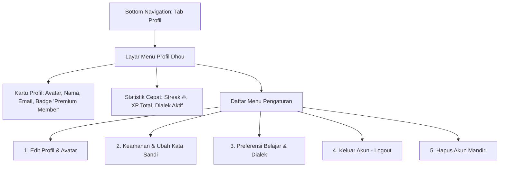
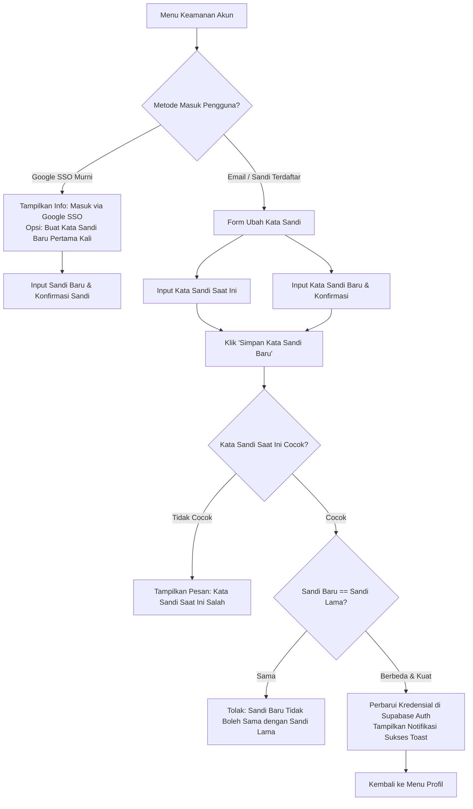
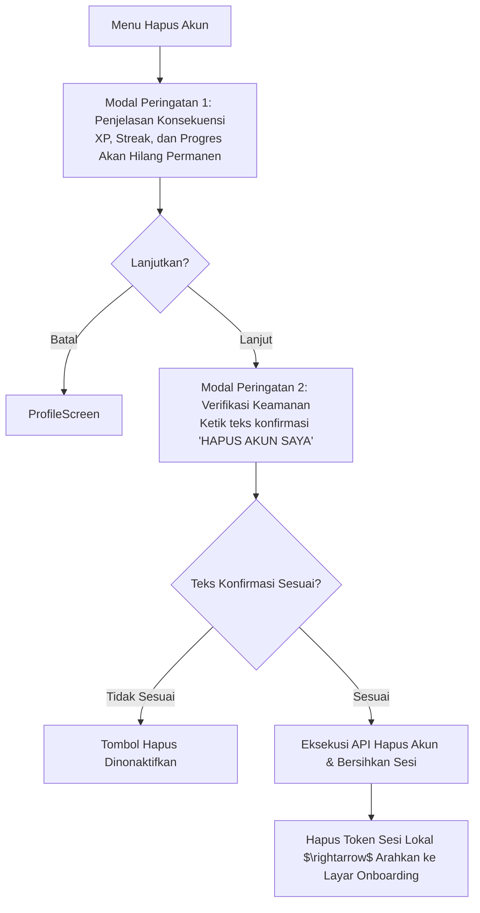

# Product Requirement Document (PRD)

## Document Information

| Item | Detail |
| :--- | :--- |
| **Document ID** | PRD5 |
| **Feature ID** | PROF-01, PROF-02, PROF-03, PROF-04, PROF-05, PROF-06 |
| **Feature Name** | User Profile, Account Management, and Security Settings |
| **Application** | Dhou (تطبيق ضوء) — Mobile Web (PWA) & iOS Native Wrapper (CapacitorJS) |
| **Module** | User Profile, Preferences & Account Lifecycle |
| **Sprint** | Sprint 5 |
| **Epic** | User Identity, Profile & Account Lifecycle |
| **Priority** | High (P1) |
| **Status** | Approved |
| **Implementation Status** | Planned |
| **Version** | 1.0 |
| **Last Updated** | 2026-11-09 |
| **Product Owner** | Fariz Mirza Abdillah |
| **Dependencies** | PRD1 (User Authentication & Session), Supabase Auth / GoTrue, PostgreSQL (`profiles` table) |

---

## 1. Business Problem

Setelah pengguna berhasil masuk ke aplikasi Dhou (PRD1), mereka membutuhkan wadah terpusat untuk mengelola identitas, memantau pencapaian belajar, menyesuaikan preferensi bahasa, serta mengamankan kredensial mereka. Saat ini timbul beberapa tantangan produk:
1. **Ketiadaan Visibilitas Status Akun & Hak Akses**: Pengguna tidak dapat melihat tipe keanggotaan mereka (*account tier*) serta ringkasan progres belajar akumulatif (total XP, streak 🔥 aktif, dan dialek utama).
2. **Keterbatasan Kontrol Kredensial Mandiri**: Pengguna yang mendaftar dengan email/password belum dapat mengganti kata sandi secara berkala dari dalam aplikasi saat sesi masih aktif (*in-app password change*), sementara pengguna Google OAuth memerlukan kejelasan status metode masuk mereka.
3. **Risiko Penolakan Apple App Store (Guideline 5.1.1v)**: Kebijakan Apple mewajibkan seluruh aplikasi yang mendukung pembuatan akun untuk menyediakan alur **Penghapusan Akun Mandiri (*Self-Serve Account Deletion*)** langsung di dalam aplikasi. Tanpa fitur ini, aplikasi Dhou berisiko ditolak saat proses review rilis iOS di TestFlight/App Store.
4. **Kehilangan Personalisasi Belajar**: Tanpa halaman profil/pengaturan, preferensi dialek default (*Fusha*, Mesir, Syam) dan pengaturan notifikasi harian tidak tersimpan permanen di cloud profil pengguna.

---

## 2. Business Value

- **Meningkatkan Kepercayaan & Loyalitas Pengguna (*User Trust & Agency*)**: Memberikan kontrol penuh atas identitas, foto profil, dan kata sandi tanpa perlu menghubungi tim bantuan operasional.
- **Transparansi Status Keanggotaan (*Early Access Premium Value*)**: Menampilkan badge **"Premium Member"** secara eksplisit kepada seluruh pengguna fase saat ini untuk meningkatkan *perceived value* sebelum monetisasi resmi diluncurkan.
- **Kepatuhan Mutlak Terhadap Standar Privasi Global & App Store**: Alur penghapusan akun mandiri yang transparan menjamin kepatuhan Apple App Store Review Guideline 5.1.1(v) dan regulasi privasi data (GDPR / UU PDP).
- **Reduksi Beban Dukungan Pelanggan (*Zero Support Ticket for Profile Updates*)**: Seluruh perubahan nama tampilan, avatar, dan kata sandi dapat diselesaikan secara instan dan mandiri $< 30$ detik.

---

## 3. Purpose

Menyediakan modul **User Profile & Account Security Management** pada aplikasi Dhou dengan antarmuka yang bersih, intuitif, ramah perangkat bergerak (*mobile-friendly*), serta mendukung perataan visual Arab-Latin yang harmonis. Modul ini menjadi pusat navigasi untuk melihat status akun, mengubah kredensial kata sandi, memperbarui identitas profil, mengonfigurasi preferensi belajar, mengakhiri sesi (*logout*), dan menghapus akun secara aman.

---

## 4. Objectives

1. Menampilkan **Kartu Profil & Status Akun** terpadu dengan badge status keanggotaan (`account_tier`: `premium` untuk seluruh pengguna pada fase rilis saat ini).
2. Menyediakan formulir **Ubah Kata Sandi Mandiri (*In-App Password Change*)** dengan validasi kata sandi lama, meter kekuatan kata sandi baru, dan penanganan khusus untuk akun Google OAuth.
3. Memfasilitasi **Pengeditan Profil Cepat (*Edit Profile*)** yang mencakup nama tampilan (*display name*) dan pemilihan galeri avatar preset karakter Dhou yang ringan.
4. Menghadirkan pengaturan **Preferensi Belajar & Dialek** terpusat untuk menyimpan dialek prioritas (*Fusha*, *'Ammiyyah Mesir*, atau *'Ammiyyah Syam*) dan toggle pengingat belajar harian.
5. Menyediakan alur **Penghapusan Akun Mandiri (*Delete Account*)** dengan dialog verifikasi ganda (*double confirmation*) dan *hard-delete / anonymization* instan untuk kepatuhan Apple App Store.
6. Mengintegrasikan tombol **Keluar Akun (*Logout*)** yang selaras dengan spesifikasi PRD1 (`AUTH-L-05`).

---

## 5. Scope

### 5.1 In-Scope (Cakupan MVP)
- **Ringkasan Profil**: Tampilan foto avatar, nama lengkap, username/email, tanggal bergabung (*member since*), serta metrik gamifikasi ringkas (total XP, streak aktif).
- **Status Akun**: Indikator status tier akun (`basic` vs `premium`), dengan aturan bisnis fase saat ini: **semua akun default = `premium`**.
- **Edit Profil**: Form perubahan nama tampilan dan pemilihan avatar preset karakter Dhou.
- **Ubah Kata Sandi**: Validasi sandi saat ini, sandi baru, konfirmasi sandi, dan proteksi salah sandi berturut-turut.
- **Penanganan Google OAuth**: Deteksi akun berbasis OAuth Google; menampilkan informasi akun terhubung dan menyembunyikan form sandi lama jika belum pernah membuat sandi lokal.
- **Preferensi Belajar**: Pengaturan dialek bawaan dan sakelar (*switch*) pengingat harian.
- **Keluar Akun (*Logout*)**: Modal konfirmasi keluar dan pembersihan sesi lokal.
- **Hapus Akun (*Account Deletion*)**: Alur konfirmasi ganda dengan input teks konfirmasi untuk mencegah ketidaksengajaan, pembersihan data auth dan profil di Supabase.

### 5.2 Out-of-Scope (Fase Lanjutan / v2)
- Pembayaran in-app purchase (IAP) atau integrasi payment gateway (Stripe/Midtrans/Apple Pay) untuk downgrade/upgrade tier berbayar.
- Fitur unggah berkas foto bebas dari galeri ponsel (menggunakan galeri avatar preset Dhou untuk menghemat bandwidth dan biaya storage cloud).
- Autentikasi dua faktor berbasis aplikasi pihak ketiga (Google Authenticator / TOTP).
- Penggabungan akun (*account merging*) antara akun Google dan akun email manual yang berbeda.

---

## 6. User Persona

1. **Ahmad (Mahasiswa Studi Timur Tengah — Early Adopter)**
   - **Kebutuhan**: Ingin memastikan status akunnya aktif dengan akses penuh (*premium*) ke semua variasi dialek (*Fusha*, Mesir, Syam) dan mengganti kata sandi akunnya secara berkala demi keamanan.
   - **Pain Point**: Bingung jika tidak ada indikator apakah akunnya sudah terhubung dengan aman dan khawatir progres streak belajarnya hilang.
2. **Sarah (Traveler & Pembelajar Mandiri)**
   - **Kebutuhan**: Mendaftar via Google Sign-In, ingin mengubah nama tampilan menjadi nama panggilannya, memilih avatar yang sesuai, dan menyetel dialek default ke *Egyptian Arabic*.
   - **Pain Point**: Khawatir tombol ubah sandi memaksanya memasukkan kata sandi lama yang tidak pernah ia buat saat mendaftar lewat Google.

---

## 7. User Flow

### 7.1 Alur Navigasi Profil & Status Akun

### 7.2 Alur Ubah Kata Sandi Mandiri (In-App Change Password)

### 7.3 Alur Penghapusan Akun Mandiri (Apple Compliance)

---

## 8. Feature Specifications (by User Story)

| No. | Nomor US | Judul US | Cakupan Fitur |
| :---: | :--- | :--- | :--- |
| 1 | **US01** | Tampilan Profil & Status Akun (PROF-01) | Header profil pengguna, foto avatar, nama, email, tanggal bergabung, badge status tier `premium`, dan ringkasan metrik belajar. |
| 2 | **US02** | Edit Profil Dasar & Pilihan Avatar (PROF-02) | Form pembaruan nama tampilan dan pemilihan koleksi avatar preset karakter Dhou yang responsif. |
| 3 | **US03** | Ubah Kata Sandi Mandiri (PROF-03) | Form ubah kata sandi dengan validasi sandi lama, sandi baru, meter kekuatan, dan penanganan khusus akun Google SSO. |
| 4 | **US04** | Preferensi Belajar & Dialek Utama (PROF-04) | Pemilihan dialek prioritas (Fusha / Mesir / Syam) dan sakelar notifikasi pengingat harian. |
| 5 | **US05** | Manajemen Sesi & Keluar Akun (PROF-05) | Konfirmasi keluar akun (`auth_logout`), pembersihan token JWT dan data cache lokal perangkat. |
| 6 | **US06** | Penghapusan Akun Mandiri (PROF-06) | Alur hapus akun dua tahap dengan konfirmasi ketik teks, pembersihan data terikat di database, dan kepatuhan App Store 5.1.1(v). |

---

### US01: Tampilan Profil & Status Akun (PROF-01)
**Sebagai** pengguna terdaftar aplikasi Dhou,  
**Saya ingin** melihat ringkasan identitas dan status akun saya di menu Profil,  
**Agar** saya mengetahui hak akses keanggotaan saya dan pencapaian akumulatif belajar saya secara transparan.

#### Alur Pengguna:
1. Pengguna mengetuk tab **Profil** di navigasi bawah (*Bottom Navigation*).
2. Sistem memuat data profil dari database lokal/Supabase:
   - Avatar pengguna aktif.
   - Nama tampilan (*Display Name*) dan alamat email.
   - Badge keanggotaan: **"Premium Member"** dengan aksen visual gold/amber.
   - Informasi waktu bergabung: *"Bergabung sejak [Bulan Tahun]"*.
   - Kartu statistik mini: Total XP terkumpul, hari streak aktif (🔥), dan dialek utama yang sedang dipelajari.

#### Kriteria Penerimaan (Acceptance Criteria):
* **AC01.1**: Seluruh pengguna aktif saat ini secara otomatis memiliki status `account_tier = 'premium'`.
* **AC01.2**: Badge "Premium Member" tampil jelas di bawah nama pengguna dengan label penjelas *"Akses Penuh Seluruh Dialek"*.
* **AC01.3**: Jika data profil gagal dimuat karena kendala jaringan, antarmuka menampilkan *skeleton placeholder* yang elegan tanpa membuat layar macet (*freeze*).
* **AC01.4**: Data streak dan XP selalu sinkron dengan status terakhir di Modul Belajar (PRD2).

---

### US02: Edit Profil Dasar & Pilihan Avatar (PROF-02)
**Sebagai** pengguna Dhou,  
**Saya ingin** mengubah nama tampilan dan memilih avatar karakter favorit saya,  
**Agar** profil belajar saya mencerminkan identitas yang personal dan nyaman dilihat.

#### Alur Pengguna:
1. Di layar Profil, pengguna mengetuk tombol **"Edit Profil"** (ikon pensil).
2. Tampil modal *bottom-sheet* berisi:
   - Pemilih Avatar Preset: Grid 6–8 pilihan avatar ilustrasi karakter Dhou.
   - Input Teks Nama Tampilan: Terisi nama saat ini dengan batasan 2–50 karakter.
3. Pengguna memilih avatar baru dan/atau memperbarui teks nama.
4. Pengguna menekan tombol **"Simpan Perubahan"**.
5. Sistem melakukan sanitasi input, menyimpan perubahan ke Supabase `profiles`, memperbarui state lokal, dan menampilkan notifikasi sukses (*toast*).

#### Kriteria Penerimaan (Acceptance Criteria):
* **AC02.1**: Nama tampilan tidak boleh kosong, minimal 2 karakter, maksimal 50 karakter, dan terhindar dari karakter skrip berbahaya (*XSS sanitization*).
* **AC02.2**: Avatar berupa preset SVG/PNG ringan yang dimuat lokal tanpa pemanggilan URL eksternal yang lambat.
* **AC02.3**: Tombol simpan berstatus *disabled* jika tidak ada perubahan data dibandingkan data saat ini.
* **AC02.4**: Perubahan nama langsung tercermin di TopBar dan layar obrolan Dhou AI tanpa perlu memuat ulang (*refresh*) aplikasi.

---

### US03: Ubah Kata Sandi Mandiri (PROF-03)
**Sebagai** pengguna yang mendaftar menggunakan email dan kata sandi,  
**Saya ingin** mengganti kata sandi saya langsung dari menu Profil,  
**Agar** saya dapat menjaga keamanan akun saya tanpa harus melalui alur lupa sandi.

#### Alur Pengguna:
1. Pengguna membuka submenu **"Keamanan Akun"** $\rightarrow$ **"Ubah Kata Sandi"**.
2. **Skenario A (Pengguna Email/Password)**:
   - Sistem menampilkan 3 kolom input: *Kata Sandi Saat Ini*, *Kata Sandi Baru*, dan *Konfirmasi Kata Sandi Baru*.
   - Pengguna mengisi ketiga kolom tersebut dengan bantuan toggle intip mata (*show/hide password*).
   - Pengguna menekan tombol **"Simpan Kata Sandi"**.
   - Sistem memverifikasi kecocokan sandi lama ke Supabase Auth. Jika benar dan sandi baru valid, sandi diperbarui.
3. **Skenario B (Pengguna Murni Google OAuth)**:
   - Sistem mendeteksi `provider = 'google'`.
   - Sistem menampilkan banner informatif: *"Akun Anda terhubung langsung dengan Google Sign-In. Anda tidak memerlukan kata sandi untuk masuk."*
   - Disediakan opsi opsional *"Buat Kata Sandi Aplikasi"* jika pengguna ingin memiliki opsi masuk alternatif dengan email dan kata sandi di kemudian hari (tanpa meminta sandi lama).

#### Kriteria Penerimaan (Acceptance Criteria):
* **AC03.1**: Kata sandi baru minimal 8 karakter, wajib mengandung kombinasi huruf dan angka.
* **AC03.2**: Kata sandi baru tidak boleh sama persis dengan kata sandi saat ini.
* **AC03.3**: Kolom konfirmasi harus identik dengan kolom kata sandi baru secara real-time.
* **AC03.4**: Jika verifikasi kata sandi saat ini gagal, tampilkan pesan error spesifik *"Kata sandi saat ini tidak sesuai"* tanpa menutup modal input.
* **AC03.5**: Setelah kata sandi berhasil diubah, tampilkan toast sukses dan catat log pembaruan kredensial.

---

### US04: Pengaturan Preferensi Belajar & Dialek Utama (PROF-04)
**Sebagai** pembelajar bahasa Arab dengan fokus tertentu,  
**Saya ingin** menentukan dialek utama dan notifikasi pengingat di menu Profil,  
**Agar** kurikulum rekomendasi video dan latihan menyesuaikan minat dialek saya.

#### Alur Pengguna:
1. Pengguna membuka submenu **"Preferensi Belajar"**.
2. Disediakan pemilih radio:
   - **Fusha (Modern Standard Arabic / الفصحى)**
   - **'Ammiyyah Mesir (Egyptian Arabic / العامية المصرية)**
   - **'Ammiyyah Syam (Levantine Arabic / العامية الشامية)**
3. Disediakan toggle switch:
   - **Pengingat Belajar Harian (Daily Reminder)**: Aktif / Nonaktif (dengan pilihan waktu pengingat default 19:30).
   - **Putar Suara Otomatis (Auto-play Audio)**: Aktif / Nonaktif.
4. Pengguna melakukan perubahan dan sistem menyimpan preferensi secara instan (*auto-save*) ke database/local storage.

#### Kriteria Penerimaan (Acceptance Criteria):
* **AC04.1**: Penggantian dialek utama di Profil secara otomatis mengubah selektor varietas di TopBar aplikasi.
* **AC04.2**: Pengaturan tersimpan secara persisten lintas sesi dan perangkat pada tabel `profiles`.

---

### US05: Manajemen Sesi & Keluar Akun (PROF-05)
**Sebagai** pengguna pada perangkat bersama atau publik,  
**Saya ingin** keluar dari akun saya dengan konfirmasi yang jelas,  
**Agar** orang lain tidak dapat mengakses riwayat belajar dan data pribadi saya.

#### Alur Pengguna:
1. Pengguna mengetuk opsi **"Keluar Akun"** di bagian bawah menu Profil.
2. Muncul dialog modal konfirmasi:
   - Judul: *"Keluar dari Akun?"*
   - Pesan: *"Progres belajar dan streak harian Anda aman di akun ini. Anda dapat masuk kembali kapan saja."*
   - Opsi: Tombol *"Batal"* (sekunder) dan *"Ya, Keluar"* (destruktif merah).
3. Pengguna mengetuk *"Ya, Keluar"*.
4. Sistem memanggil fungsi logout Supabase, membersihkan token JWT di storage perangkat, me-reset state aplikasi, dan mengarahkan pengguna ke layar Masuk (*Login Screen*).

#### Kriteria Penerimaan (Acceptance Criteria):
* **AC05.1**: Modal konfirmasi wajib muncul sebelum aksi keluar dijalankan untuk mencegah sentuhan tidak sengaja (*accidental click*).
* **AC05.2**: Token auth, refresh token, dan cache lokal dibersihkan secara tuntas.
* **AC05.3**: Menghormati spesifikasi integrasi `AUTH-L-05` pada PRD1.

---

### US06: Penghapusan Akun Mandiri (PROF-06 — App Store Compliance)
**Sebagai** pengguna yang ingin menghentikan penggunaan layanan secara permanen,  
**Saya ingin** menghapus akun dan data saya secara mandiri dari dalam aplikasi,  
**Agar** privasi data saya terlindungi sesuai hak pengguna dan standar Apple App Store.

#### Alur Pengguna:
1. Pengguna membuka opsi **"Zona Bahaya"** $\rightarrow$ **"Hapus Akun"**.
2. Muncul layar/modal konfirmasi tingkat 1:
   - Penjelasan transparan bahwa tindakan bersifat **permanen dan tidak dapat dibatalkan**.
   - Rincian data yang akan dihapus: Seluruh streak harian (🔥), total XP, kartu hafalan kosakata SRS, riwayat percakapan AI, dan profil akun.
3. Jika pengguna memilih *"Tetap Hapus"*, muncul layar/modal verifikasi tingkat 2:
   - Pengguna diwajibkan mengetikkan frasa konfirmasi: **`HAPUS AKUN SAYA`**.
4. Tombol aksi final *"Hapus Akun Permanen"* hanya dapat ditekan jika teks konfirmasi tepat 100%.
5. Sistem mengeksekusi RPC penghapusan akun di Supabase (menghapus identitas auth, melepaskan data terikat, dan mencatat anonimitas audit).
6. Pengguna dikeluarkan secara otomatis dan diarahkan ke layar pendaftaran awal dengan notifikasi pamit.

#### Kriteria Penerimaan (Acceptance Criteria):
* **AC06.1**: Memenuhi persyaratan Apple App Store Review Guideline Section 5.1.1(v) secara penuh.
* **AC06.2**: Alur pencegahan salah tekan tingkat ganda (*two-tier double confirmation*) wajib diterapkan.
* **AC06.3**: Seluruh data yang terkait dengan `user_id` di tabel profil dan riwayat belajar dihapus atau dianonimkan secara permanen (*cascade delete*).
* **AC06.4**: Proses penghapusan akun wajib selesai dalam waktu $\le 3$ detik.

---

## 9. Business Rules Summary

| ID Aturan | Judul Aturan | Detail Logika & Batasan Sistem |
| :--- | :--- | :--- |
| **BR-PROF-01** | **Default Account Tier** | Seluruh pengguna yang terdaftar pada sistem Dhou saat ini secara default memiliki status `account_tier = 'premium'`. Nilai ini memberikan hak akses penuh ke seluruh konten belajar dan variasi dialek tanpa batasan energi atau unit terkunci. |
| **BR-PROF-02** | **Proteksi Kata Sandi** | Perubahan kata sandi memerlukan verifikasi kata sandi saat ini yang valid. Sandi baru minimal 8 karakter dan tidak boleh identik dengan sandi lama. |
| **BR-PROF-03** | **Awareness Akun Google SSO** | Akun yang hanya terdaftar melalui Google OAuth tidak memiliki hash kata sandi lama; antarmuka tidak boleh meminta input kata sandi lama, melainkan menawarkan opsi menetapkan sandi baru pertama kali (*set new password*). |
| **BR-PROF-04** | **Sanitasi Nama Tampilan** | Nama tampilan dibatasi 2–50 karakter, dipangkas dari whitespace berlebih (*trimmed*), dan dibersihkan dari tag HTML/skrip injection. |
| **BR-PROF-05** | **Preset Avatar Lokal** | Pilihan avatar berasal dari kumpulan ID preset bawaan (misal: `avatar_01` s.d. `avatar_08`) untuk menjamin konsistensi visual dan performa render instan tanpa latensi upload media. |
| **BR-PROF-06** | **Sinkronisasi Dialek Utama** | Perubahan dialek utama di menu Profil secara otomatis memperbarui preferensi global aplikasi dan status aktif variasi di modul kuis dan obrolan AI. |
| **BR-PROF-07** | **Konfirmasi Hapus Akun Ketat** | Penghapusan akun wajib melewati verifikasi ketik teks konfirmasi persis `HAPUS AKUN SAYA` guna memitigasi klaim ketidaksengajaan. |
| **BR-PROF-08** | **Kompabilitas Safe-Area & RTL** | Seluruh tata letak menu profil menghormati area aman iOS (`env(safe-area-inset-top)` & `env(safe-area-inset-bottom)`) serta font Arab berharakat longgar (line-height $\ge 1.6$). |

---

## 10. Business Metrics & KPIs

1. **Self-Service Resolution Rate**: $\ge 98\%$ permintaan perubahan profil dan kata sandi diselesaikan mandiri oleh pengguna tanpa tiket bantuan operasional.
2. **Account Deletion Success Rate**: $100\%$ eksekusi penghapusan akun berhasil memutus sesi dan membersihkan data dalam $< 3$ detik tanpa menyisakan *orphan data* di database.
3. **App Store Review Compliance**: $0$ temuan penolakan (*zero rejection*) terkait Apple App Store Review Guideline 5.1.1(v) pada saat submission build iOS.
4. **Profile Engagement**: $\ge 60\%$ pengguna baru menyesuaikan nama tampilan atau avatar mereka dalam 7 hari pertama pendaftaran.

---

## 11. Rujukan Spesifikasi Implementasi

- **PRD1**: User Authentication, Sign In, and Password Recovery (`Requirements/PRD/PRD1 - User Authentication, Sign In, and Password Recovery.md`).
- **FRD1**: Spesifikasi Fungsi Logout & Sesi Supabase Auth (`Requirements/FRD/FRD1 - User Authentication, Sign In, and Password Recovery.md`).
- **Design System Tokens**: Typography Fredoka & Amiri, Palette Emerald/Slate/Amber (`design-system.md`).
- **Apple App Store Review Guidelines**: Guideline 5.1.1(v) — Account Deletion Requirement.
